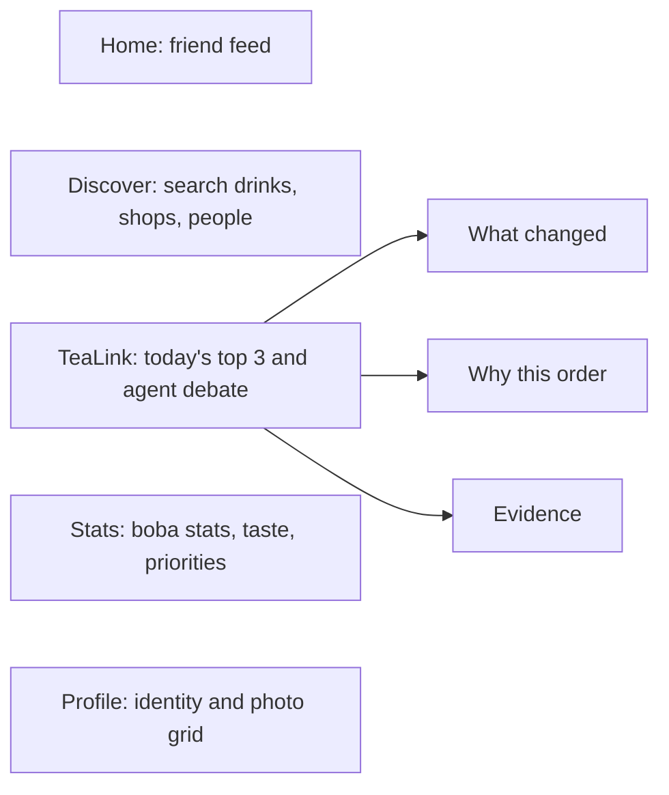

# TeaLink plan

*Living document, so anyone can edit it. Last edited Sat Oct 10, 3:35 PM. Mark status with ✅ done, 🟡 in progress, ⬜ not started, or ✂️ cut. Log what you finished in [`PROGRESS.md`](PROGRESS.md) and record plan changes in the log at the bottom.*

## Goal

**Cisco Cloud AI track, "When AI Agents Disagree."** We're targeting **Level 2 (Adaptive AI Team)**, plus two Level 3 pieces: a baseline comparison and an ask-the-human rule.

TeaLink is an explainable boba recommender. A team of agents with different goals argues over what you should order next. You get a top 3, you pick one, and the team learns what you care about.

## Key decisions

- **Agents** run on AGNTCY `agntcy-app-sdk`, using A2A over **NATS**. SLIM group chat is a stretch goal.
- **Fallback:** setting `TRANSPORT=local` runs the same agent classes in-process. This is the current default, and the demo never depends on the message bus.
- **Numbers come from code, never the LLM.** Scores, weights, vetoes, rankings, and the learned priorities are all computed in code. An LLM may only reword rationales (optional, through LiteLLM and the `LLM_MODEL` setting, with fixed template wording otherwise).
- **The user picks from a top 3** rather than getting a single answer. Each pick is a learning signal. *(Changed 12:50 PM.)*
- **Each agent has its own objective.** Every agent scores every candidate by its own objective, and the resolver blends those scores with weights learned for this user. No agent gets a casting vote. *(Changed 12:50 PM.)*
- **TeaLink is social.** Profiles, boba stats, follows, and a friends feed sit around the recommender, and a first-visit quiz seeds the Preference agent. See "Social layer" under the two-person split. *(Added 2:55 PM.)*
## Agent team

| Agent | Objective | Proposes? | Notes |
|---|---|---|---|
| Taste | Fit to the user's own reviews (`taste`) | Top 3 | Cites the user's reviews as evidence |
| Social | What the most similar users rated highly (`social`) | Top 3 untried, taste ≥ 0.5 | Similarity is the centered cosine of taste profiles. A drink nobody has rated scores neutral (0.5) |
| Explorer | Something new that's still a plausible fit (`novelty`) | Top 3 untried, taste ≥ 0.6 | |
| Budget | Cheapest that still fits (`cost`) | Top 3, taste ≥ 0.7 | |
| Shop (one per shop) | Inventory truth | No | Confirms stock or vetoes sold-out drinks. If a shop has no online agent, its drinks are dropped |
| Preference | Learns how much this user weighs each objective | No | Seeded from past picks (`data/choices.json`) and updated on every pick from the top 3 |

## Deliberation protocol

Schemas are in `backend/tealink/schemas.py`, mirrored in `frontend/src/api/types.ts`.

1. **Select.** The Concierge picks agents based on what their cards say they can do, and logs why it picked each one.
2. **Preference.** The Preference agent reports the user's current weights, for example taste 39%, price 42%, novelty 5%, and friends 14%.
3. **Propose.** Each objective agent proposes up to 3 drinks, each with evidence and a rationale.
4. **Object.** Every agent scores every candidate on its own objective. It supports a drink at 0.55 or above, raises a concern below 0.45, and is neutral in between. Shops veto anything sold out.
5. **Resolve.** The Concierge drops vetoed drinks and drinks with no confirming shop, then ranks the rest by the weighted sum of objective scores and returns the top 3. If the top two are within **0.02** of each other, or everything was ruled out, it sets `ask_human`.
6. **Learn.** `POST /choices` records the user's pick. The Preference agent nudges the weights toward the objectives where the pick beat the drinks the user passed over (learning rate 0.25, minimum weight 5%), then explains the change.
7. Every step streams to the frontend as a `LensEvent` over Server-Sent Events.

## How each Level 2 requirement is met

| Requirement | How | Status |
|---|---|---|
| Agents chosen by capability | Registry, agent cards, and the selection reasons the Concierge logs | ✅ |
| Unexpected change | A shop sells out (and vetoes the drink), or a shop goes offline (and its drinks are dropped) | ✅ |
| Dynamic discovery | Lantern Leaf registers a shop agent partway through a session | ✅ |
| Conflict resolution | The resolver blends objective scores with learned weights, plus an ask-the-human rule | ✅ |
| Explain who was selected and why | Lens timeline and the Why This page (score times weight, plus ruled-out drinks) | ✅ |
| New information changes the decision | User picks update the weights. Brown sugar dislike, sell-outs, and shop joins each trigger a fresh deliberation | ✅ |
| *Level 3:* baseline comparison | Popularity 2/24 hits, fixed weights 5/24, learning 7/24. `GET /eval` serves `eval_results.json` | ✅ |
| *Level 3:* ask the human | Near-tie or everything ruled out shows a prompt over the top 3 | ✅ |
| AGNTCY transport | `AgntcyTransport` over NATS | ✅ (go: demo flow passes on NATS, local stays the default) |

## Repo layout (current)

```
TeaLink/
  README.md  docs/PLAN.md  docs/PROGRESS.md  docs/architecture.md (todo)
  backend/
    tealink/
      schemas.py  config.py  llm.py
      data/seed.py  loader.py                 # writes backend/data/{shops,drinks,users,reviews,choices}.json
      core/taste.py  retrieval.py  similarity.py  objectives.py  preferences.py  resolution.py  baseline.py
           quiz.py  stats.py                  # onboarding quiz mapping, boba stats and personality
      social/store.py  # profiles, follows, feed (in memory, loaded from data/social.json)
      api/social.py    # /quiz, /users, /users/{id}[/follow|/followers|/following], /feed, /recs
      agents/objective_agent.py  taste_agent.py  social_agent.py  explorer_agent.py
             budget_agent.py  shop_agent.py  preference_agent.py  cards.py  roster.py  serve.py
      concierge/transport.py  registry.py  deliberation.py
      api/main.py      # /recommend (SSE), /choices, /preferences/{user}, /profile, /users/similar,
                       # /eval, /events/{sold-out,shop-join,shop-offline,preference,reset}
    eval/run_eval.py   # learning vs fixed weights on simulated users with hidden priorities
    tests/             # taste, resolution, preferences, end-to-end demo flow
  frontend/src/
    pages/Discover.tsx  WhyThis.tsx  Counterfactual.tsx  Friends.tsx
    components/TopChoices.tsx  PriorityBars.tsx  TasteBars.tsx  AgentTimeline.tsx  ControlPanel.tsx
    state/session.ts  api/client.ts  api/types.ts  mocks/sample_session.json
```

## Already done (Phases 0 to 2, plus most of 3)

- ✅ Skeleton, schemas and types, SSE gateway, seed data (6 shops, 43 drinks, users, reviews, and Andrew's past picks)
- ✅ All six agent kinds, capability selection, both rounds, the resolver, top 3, and the learning Preference agent
- ✅ Discover and Why This on live data, the timeline, and control panel buttons that re-run deliberation
- ✅ Sold-out, shop offline, shop joining mid-session, the preference flip, and ask-the-human
- ✅ **6:00 checkpoint met early:** real disagreement on screen, end to end

## Two-person split

The remaining work runs as two parallel tracks. **Track A** is the backend: agents, transport, and evidence. **Track B** is the frontend, demo, and write-ups. Each track owns its files outright, so the two of you don't block each other or hit merge conflicts. The default is Andrew on A and Emily on B; swap if you prefer.

### Ground rules

1. **First, together (1:15 to 1:30):** merge `feature/top3-preference-learning` into `main`. Both pull, and both confirm `make api` and `make web` run.
2. **Branches:** A works on `a/<topic>` and B works on `b/<topic>`. Open small PRs into `main`, merge at every sync point, and pull `main` right after.
3. **Shared files:** `schemas.py` and `types.ts` are the only shared files. A changes `schemas.py` and posts the diff in chat. B then mirrors it in `types.ts`. Neither of you changes the other's files.
4. **Never blocked:** B builds against mock JSON in `frontend/src/mocks/` that matches the contracts below. A tests with `pytest` and `curl`. The real data replaces the mocks once A merges.
5. **`PROGRESS.md`:** whoever merges a PR updates their own track's section.

### File ownership

| Track A owns (backend) | Track B owns (frontend, demo, docs) |
|---|---|
| `backend/tealink/**` (agents, core, concierge, api, data/seed) | `frontend/src/**` |
| `backend/eval/**`, `backend/tests/**`, `backend/data/*.json` | `frontend/src/mocks/**` (including mocks for A's upcoming endpoints) |
| `Makefile`, `docker-compose.yml`, `.env.example` | `docs/demo-script.md`, `docs/writeup.md`, the demo video |
| `docs/architecture.md` | `README.md` (A sends B notes on endpoints and setup) |

### Contracts to agree on now

So B can build the UI before A's backend is ready:

```ts
// GET /eval  (A serves backend/data/eval_results.json; B mocks frontend/src/mocks/eval.json)
type EvalResult = {
  rounds: number;
  methods: {
    method: "popularity" | "fixed_weights" | "learning";
    hit_rate: number;        // 0..1: the team's #1 was the drink the user picked
    top3_rate: number;       // 0..1: the pick was anywhere in the top 3
    sold_out_recs: number;   // how many recommendations were sold out
    repeat_rate: number;     // 0..1: share of recommendations the user had already tried
  }[];
  personas: {
    name: string;
    hidden_weights: Record<Dimension, number>;
    learned_weights: Record<Dimension, number>;
  }[];
};

// Stretch, only if A builds shop offers: a new optional field and a new event type
type Offer = { shop_id: string; percent: number; price_after: number; reason: string };
// RankedDrink.offer?: Offer | null      LensEventType adds "offer"
```

### Track A: backend, agents, evidence

| When | Task | Done when |
|---|---|---|
| 1:30 to 2:00 | ✅ **AGNTCY spike.** Get one Taste agent answering over NATS through `AgntcyTransport` (`docker compose up nats`, then `python -m tealink.agents.serve --agent taste`) | One `/recommend` with `TRANSPORT=agntcy` gets a Taste reply over NATS |
| **2:00** | **Go/no-go.** Go. Stay able to run `TRANSPORT=local`. B does not need a frontend change | |
| 2:00 to 3:30 | ✅ If go: serve every agent over NATS, run shop heartbeats over the bus, add `make agents`, and a startup fallback to local. If no-go: skip straight to the baseline | The demo flow passes on both transports |
| 3:30 to 5:00 | ✅ `core/baseline.py` (most-reviewed untried in-stock drink). Extend `eval/run_eval.py` to popularity vs fixed weights vs learning, write `eval_results.json`, and add `GET /eval` | `GET /eval` matches the contract, with a test |
| 5:00 to 6:00 | ✅ Story data fixes: tune Sarah's seed reviews so she's Andrew's top match, re-seed, and update the tests | `/users/similar?user_id=andrew` returns Sarah first |
| **6:00** | **Sync:** merge, then run the full demo together | |
| 6:30 to 8:00 | ⬜ Stretch: **shop offers.** In a near-tie, the trailing shop's agent offers up to 10% off from its budget. The resolver re-scores the cost dimension, and an `offer` event is emitted | The offer appears in the timeline and can flip the #1 |
| 8:00 to 9:00 | ⬜ Optional LLM wording for rationales (template fallback stays the default). Edge-case tests: all vetoed, no reviews, every shop offline | Tests pass with no API key set |
| **9:00** | **Merge.** Feature freeze at 9:30 | |
| Overnight | ⬜ `docs/architecture.md`: mermaid diagram, protocol, Level 2 mapping | |
| Sun 9:00 to 11:30 | Backend bug fixes; architecture and implementation sections of the write-up | |

### Track B: frontend, demo, write-ups

| When | Task | Done when |
|---|---|---|
| 1:30 to 3:00 | ✅ **Counterfactual page on live data.** Show a before/after of the top 3 using `previousDecision` and `decision` from the session store: what moved, what was ruled out, which event caused it, and the weight shifts | Clicking any control button, then opening Counterfactual, shows the real diff |
| 3:00 to 4:00 | ✅ Clean-up: update `sample_session.json` so the offline fallback shows the top 3 and priorities; delete `RecommendationCard.tsx`; point Friends at `/users/similar` (or hide the tab) | `npm run build` and lint pass; the app still works with the API stopped |
| 4:00 to 6:00 | ✅ **Evidence page** (`/evidence`) built against `mocks/eval.json`: a methods table, hit-rate bars, and hidden vs learned weights per persona | Renders from the mock, then switches to `GET /eval` after A merges |
| **6:00** | **Sync:** merge, then run the full demo together | |
| 6:30 to 7:30 | ✅ Ask-the-human polish: when `ask_human` is set, the prompt names both options and what separates them, and the pick resolves it. Timeline readability (group by round, collapse selection events) | A judge can follow one run without explanation |
| 7:30 to 9:00 | 🟡 `docs/demo-script.md` (written and checked against the API; dry runs and the offer badge are left) (exact clicks and lines, 3 minutes). If A builds offers, add an offer badge on cards and an `offer` timeline style | Two dry runs from a reset |
| **9:00** | **Merge.** Feature freeze at 9:30 | |
| Sun 9:00 to 11:30 | UI polish; results and lessons sections of `docs/writeup.md`; record the backup demo video | |

### Social layer (added 2:55 PM)

**Goal:** TeaLink should feel like a social app, not a tool. Users follow each other, react to what friends drink, show off their boba stats on a profile they customize, and get personalized from their very first visit through a short quiz.

**Inspiration, borrowing one idea from each:**
- **Instagram:** a profile header (avatar, name, bio, follower counts), a grid of drinks tried, and a bottom tab bar on phones.
- **Letterboxd:** log and rate drinks, with short reviews friends can like and comment on.
- **Spotify Wrapped:** a bold, shareable "Boba card" of your stats.
- **Strava:** a friends feed of activity ("Sarah tried Osmanthus Milk Tea, 5/5") with quick reactions.
- **BuzzFeed / 16Personalities:** a fun onboarding quiz that ends in a named "boba personality."

**Features:**
1. **Onboarding quiz** (6 questions, under a minute) for new users:
   - **Questions:** sweetness level, milk vs fruit vs tea-forward, toppings, flavors you like (multi-select over the `drinks.json` flavor tags), typical budget, and how adventurous you are. The exact questions and option ids are in `frontend/src/mocks/social/quiz.json`; A can serve that file from `GET /quiz` as is.
   - **Results:** your starting taste profile, your starting priority weights for the Preference agent, and a boba personality, such as "Floral Explorer" or "Brown Sugar Loyalist."
   - **Rule:** like every other number in TeaLink, the backend computes the mapping from answers to profile and weights in code.
2. **Boba stats:**
   - favorite drink and favorite store;
   - sweet vs not sweet;
   - go-to toppings;
   - milk vs fruit split;
   - drinks tried and shops visited;
   - a weekly streak;
   - top taste notes;
   - the learned priority mix ("cares most about price").
   Each stat has a show/hide toggle, so the user chooses what's public.
3. **Customizable profile:**
   - display name, @handle, and bio;
   - avatar (an emoji plus a background color, so no image uploads);
   - a pinned favorite drink and store;
   - a profile accent color;
   - which stats to show, and in what order.
4. **Interacting with other users:**
   - follow and unfollow;
   - a friends feed of reviews and picks;
   - likes and short comments;
   - "send a rec" to a friend;
   - "% taste match" on every profile (reuses the existing similarity code).

**Ground rules:**
- **The demo stays safe.** Andrew (the demo user) is already onboarded, so the 3-minute demo doesn't depend on any social feature. Reset demo also restores the social seed data.
- **No real accounts.** "Signing up" just picks a handle, and the user id is kept in `localStorage`. Social data lives in JSON files and in memory, like picks do today.
- **How it ties into the agents:**
  - The quiz solves the Preference agent's cold start: it gives a new user non-default weights from round one.
  - Follows can optionally feed the Social agent (people you follow count a little more).

**Contracts** (A adds these to `schemas.py`; B mirrors them in `types.ts` and builds against mocks first):

```ts
type StatKey = "fav_drink" | "fav_shop" | "sweetness" | "toppings" | "milk_vs_fruit"
             | "tried_count" | "shops_visited" | "streak" | "top_notes" | "priorities";

type BobaStats = {
  fav_drink_id: string | null; fav_shop_id: string | null;
  sweetness: number;                  // 0 = not sweet, 1 = very sweet
  toppings: number;                   // 0 = no toppings, 1 = loaded (the drinks' `toppings` attribute)
  milk_vs_fruit: number;              // 0 = fruit, 1 = milk
  tried_count: number; shops_visited: number; streak_weeks: number;
  top_notes: string[];                // flavor tags from drinks.json, e.g. ["brown_sugar", "oolong"]
  priorities: Record<Dimension, number>;
  personality: string;                // "Floral Explorer"
};

type UserProfile = {
  user_id: string; handle: string; display_name: string; bio: string;
  avatar: { emoji: string; color: string }; accent: string;
  pinned_drink_id: string | null; pinned_shop_id: string | null;
  visible_stats: StatKey[];           // in display order; hidden stats are left out
  followers: number; following: number; followed_by_me: boolean;
  taste_match: number | null;         // 0..1 vs the viewer
  stats: Partial<BobaStats>;          // only the visible stats for other viewers
};

type QuizQuestion = { id: string; prompt: string; options: { id: string; label: string; emoji?: string }[]; multi?: boolean };
type QuizResult = { user_id: string; personality: string; stats: BobaStats; weights: Record<Dimension, number> };

type Author = { handle: string; display_name: string; avatar: { emoji: string; color: string } };

type FeedItem = {
  id: string; user_id: string; author: Author; kind: "review" | "pick" | "rec" | "joined";
  drink_id: string | null; rating: number | null; text: string | null;
  to_user_id?: string; to_author?: Author;   // recs only
  created_at: string; likes: number; liked_by_me: boolean;
  comments: { id: string; user_id: string; author: Author; text: string; created_at: string }[];
};
```

**Endpoints (A):**
- **Quiz and sign-up:**
  - `GET /quiz` returns the questions.
  - `POST /users` takes `{handle, display_name}`, creates a user, and returns the profile.
  - `POST /quiz` takes `{user_id, answers}` (question id → chosen option ids) and returns a `QuizResult`. It also seeds the Preference agent.
- **Profiles:**
  - `GET /users?viewer=` returns `UserProfile[]` of everyone else, best taste match first (for "Suggested for you").
  - `GET /users/{id}?viewer=` returns a `UserProfile`. `{id}` may be a user id or a handle.
  - `PATCH /users/{id}` saves profile edits.
  - `POST /users/{id}/follow` and `DELETE /users/{id}/follow` take `{viewer}`.
- **Feed:**
  - `GET /feed?user_id=` returns the viewer's feed: their own posts, people they follow, and recs sent to them, newest first. Adding `&author=` returns only that author's posts (for profile pages).
  - A missing user or item returns 404 with a specific `detail`, not FastAPI's default "Not Found". The frontend treats "Not Found" as "route not shipped yet" and falls back to mocks.
  - `POST /feed/{id}/like` likes an item and `DELETE /feed/{id}/like` unlikes it. Both take `{viewer}` and return the updated `FeedItem`.
  - `POST /feed/{id}/comments` takes `{viewer, text}` and returns the updated `FeedItem`.
  - `POST /recs` takes `{from, to, drink_id, text}` to send a recommendation.

The existing `GET /profile/{id}` (taste profile) stays as it is.

#### Track A: social backend

| When | Task | Done when |
|---|---|---|
| 3:00 to 4:00 | ✅ Schemas above in `schemas.py`; seed social data for the existing users (handles, bios, avatars, follows, a few feed items from real reviews); Reset demo restores it | Seed loads, and `GET /users/sarah?viewer=andrew` returns a full profile |
| 4:00 to 5:00 | ✅ `core/stats.py`: boba stats and personality from reviews and picks. Quiz questions and the answer → taste profile + weights mapping (`core/quiz.py`), unit-tested | `POST /quiz` returns stats and weights; a new user's first `/recommend` uses those weights |
| 5:00 to 6:00 | ✅ Profile, follow, feed, like, comment, and rec endpoints; picks and reviews post feed items; visibility respected for other viewers | Tests cover hidden stats, follow counts, and feed order |
| 8:00 to 9:00 | ⬜ Optional: Social agent gives a small boost to people the user follows (replaces the LLM wording block if time is short) | The boost shows up in the Social agent's evidence |

#### Track B: social frontend

| When | Task | Done when |
|---|---|---|
| 3:00 to 4:00 | ✅ Mirror the contracts in `types.ts`, mocks in `frontend/src/mocks/social/`, client calls with mock fallback. App shell: bottom tab bar on phones (Home, Discover, Profile), top nav on desktop | Every new screen renders from mocks with the API stopped |
| 4:00 to 5:00 | ⬜ **Onboarding quiz** at `/welcome`: one question per screen, big tappable option cards, progress bar, then a personality reveal and a "Boba card" (Wrapped-style). New visitors without a user id land here | Finishing the quiz creates a user and opens Discover with their own weights |
| 5:00 to 6:00 | ✅ (done early) **Profile page** at `/u/:handle`: Instagram-style header, stats grid, pinned drink and store, drinks-tried grid, taste match, follow button. **Edit profile** sheet: name, bio, emoji avatar and color, accent, show/hide and reorder stats | Edits and hidden stats persist after a reload |
| **6:00** | **Sync:** merge, then run the full demo plus the quiz once | |
| 6:30 to 8:00 | 🟡 (started early; likes, comments, and suggestions are done; "send a rec," "Try this," and folding in Friends are left) **Home feed**: friend activity cards, likes, comments, "send a rec," and "Try this" that opens Discover. Fold the current Friends page into profiles and follow lists | Liking and commenting work on two users in two tabs |
| 8:00 to 9:00 | ⬜ Offer badge if A built offers (from the earlier block); demo script gains an optional 20-second "social" beat (quiz → profile → feed) | Main demo still fits in 3 minutes without the social beat |

**If time runs short, cut in this order:** comments and recs, then the feed, then stat reordering. **Keep:** the quiz and the profile with stats toggles.

### UI cleanup and five tabs (added 3:30 PM)

**Goal:** Every screen is easy to read at a glance. The app is organized into five clear tabs, and drinks, reviews, and profiles have pictures.

**Five tabs.** The same five tabs appear in the bottom bar on phones and the top nav on desktop:
- **Home** (`/home`): the friends feed.
- **Discover** (`/discover`): browse and search drinks, shops, and people, with filter chips (milk, fruit, or tea; under $5; flavor tags). Tapping a drink opens a detail sheet with its photo, shop, price, and friends' ratings.
- **TeaLink** (`/`, the center tab): today's picks.
  - This is the current agent recommender, reframed as "today's top 3": the close call, the debate, What changed, and Why this order.
  - What changed, Why this order, and Evidence become links inside this tab instead of items in the main nav.
  - It stays at `/`, so the demo URL and `docs/demo-script.md` don't change.
- **Stats** (`/stats`): your own stats.
  - The boba stats grid, taste profile, and learned priorities.
  - The Wrapped-style Boba card.
  - Stat visibility settings.
- **Profile** (`/u/:handle`): identity and posts.
  - Cover, avatar, bio, and personality.
  - A compact row of stat highlights that links to Stats.
  - Go-to order.
  - An Instagram-style photo grid of reviews.

The current Friends page folds into Discover (the people results) and profiles.



**Readability rules for every screen:**
- **Layout:** one main column, at most about 640px wide on phones, with one primary action per screen.
- **Type:** a consistent scale of page title, section title, body, and caption. Body text is at least 15px, and muted text still passes contrast.
- **Fewer boxes inside boxes:** sections are separated by spacing and headers, not nested cards.
- **Touch and states:** tap targets are at least 44px, and every list has a clear empty, loading, and error state.
- **TeaLink timeline:** the agent timeline is collapsed by default behind "See how the agents decided." During the demo it opens with one tap.

**Pictures (placeholders now, uploads later):**
- **Drinks:** about 10 generated images, one per drink style:
  - classic milk tea, brown sugar, fruit tea, matcha, taro;
  - Thai tea, hojicha, floral or oolong, horchata or ube, coffee.
  Each drink maps to one by its flavor tags. Stored in `frontend/public/img/drinks/`.
- **Shops:** 6 generated storefront images in `frontend/public/img/shops/`.
- **Profiles:** about 6 generated cover images to choose from in Edit profile.
- **Where they appear:** review cards in the feed, drink cards on TeaLink and Discover, the profile photo grid, the profile cover, and the Discover detail sheet.
- **Future uploads:** the contract reserves photo fields that stay `null` for now. When a URL is present, it replaces the placeholder, so adding real uploads later needs no frontend change.

**Contract additions** (A adds them; B mirrors them in `types.ts`):

```ts
// All optional and null for now; the frontend falls back to placeholders.
FeedItem.photo_url?: string | null;      // a review photo, for future uploads
UserProfile.cover_url?: string | null;   // a chosen placeholder id, or an uploaded image URL later
// GET /drinks -> { id, name, shop_id, price, flavor_tags, photo_url }[]  (replaces the frontend's copied catalog)
```

Search runs in the browser over `GET /drinks`, the shop list, and `GET /users`. The data is small (43 drinks, 6 shops, 15 users), so no search endpoint is needed.

#### Track A: UI cleanup support

| When | Task | Done when |
|---|---|---|
| 5:00 to 6:00 (or earlier, since the social endpoints are done) | ⬜ `GET /drinks`, plus the reserved `photo_url` on feed items and `cover_url` on profiles | `GET /drinks` returns all 43 drinks, and the new fields come back as `null` |
| After the freeze | ⬜ Stretch: a photo upload endpoint for review and profile photos | An uploaded photo's URL comes back in `photo_url` / `cover_url` |

#### Track B: UI cleanup

This reshuffles B's remaining evening; the earlier Track B social rows keep their tasks but follow this order.

| When | Task | Done when |
|---|---|---|
| 4:00 to 5:00 | ⬜ Onboarding quiz and Boba card (unchanged) | See the social-frontend table |
| 5:00 to 6:00 | ⬜ Five-tab navigation and routes; the TeaLink tab links to What changed, Why this order, and Evidence; Friends folded in | Every tab works on phone and desktop, and the demo script still runs from `/` |
| **6:00** | **Sync:** merge, then run the full demo plus the quiz once | |
| 6:30 to 7:30 | ⬜ Generate the placeholder images; Discover with search, filters, and the drink detail sheet | Searching "matcha" finds drinks, shops, and people |
| 7:30 to 8:30 | ⬜ Stats tab, then a readability pass across all tabs; photos on review cards and the profile grid | Every screen follows the readability rules above |
| 8:30 to 9:00 | ⬜ Feed leftovers ("send a rec") and the offer badge, if A built offers | |

### Sync points

| Time | Both of you |
|---|---|
| 1:15 | Merge the feature branch. Both run the app |
| 2:00 | AGNTCY go/no-go (A tells B) |
| 4:00 | Quick merge of whatever is ready; B checks `GET /eval` progress |
| 6:00 | Merge, then a full demo run-through. Re-cut scope if anything is behind |
| 9:00 to 9:30 | Final merge and freeze. Push before the venue closes |
| Sun 11:30 to 12:15 | Rehearse three times together. **Submit by 12:30** |

If one track finishes early, take the other track's next unstarted task, but say so first so you don't both pick it up.

## Demo script

See [`demo-script.md`](demo-script.md): a 3-minute run with exact clicks, lines, and real numbers, plus answers to likely judge questions. The order is: reset, top 3 with a close call, pick Pearl Milk Tea, #1 sells out, Lantern Leaf joins, no brown sugar (then open What changed), Sunright goes offline, Why this order, Evidence.

## If we fall behind, cut in this order

1. UI cleanup extras: the Discover filters and detail sheet (keep the search box)
2. Shop images and cover images (keep the drink images)
3. Social layer extras: comments and recs, then the feed (keep the quiz and profile if at all possible)
4. Friends tab (once profiles exist, it folds into them)
5. Counterfactual page (Why This and the timeline already show the before/after)
6. LLM wording
7. AGNTCY (use the local transport)

**Never cut:** conflict resolution, sold-out, the Lens timeline, top 3 with learning, the baseline comparison, or the TeaLink tab at `/` (the demo runs there).

## Stretch ideas (only after the freeze-safe build)

- Shop offers: a shop agent may offer a small discount, bounded by the shop's budget, to win a close call. It would show up as a cost change in the resolver.
- Group mode: several users' Preference agents negotiate over one order (SLIM group chat).
- TBAC / agent identity from AGNTCY.

## Plan change log

- **3:35 PM:** Merged Track A's social backend into main with Track B's social frontend. The API now matches the 3:10 contract: bare lists, `{viewer}` on likes and comments, `author` on feed items, `&author=` on the feed, toppings as a 0–1 number, and the quiz questions from `mocks/social/quiz.json`.
- **3:30 PM:** Added "UI cleanup and five tabs":
  - Five tabs: Home, Discover/search, TeaLink (today's picks, at `/`), Stats, and Profile.
  - Readability rules for every screen.
  - Placeholder pictures for drinks, shops, and profile covers. User uploads come later, through reserved `photo_url` and `cover_url` fields.
  - `GET /drinks` for Track A.
  - Track B's evening re-ordered: quiz, then tabs, then Discover and pictures, then Stats and the readability pass.
  - The extras go first on the cut list.
- **3:10 PM:** Contract fixes before anyone builds on them:
  - `BobaStats.toppings` is a 0–1 number and `top_notes` is a list of flavor tags, matching what `drinks.json` actually stores.
  - Added `GET /users?viewer=` (suggestions) and `DELETE /feed/{id}/like`.
  - Like and comment calls return the updated item.
  - The quiz's sixth question is flavors rather than a favorite shop, with its questions in `mocks/social/quiz.json`.
  - Feed items and comments carry an `author` (handle, name, avatar), so the feed doesn't need one request per post.
  - `GET /feed` takes `&author=` for profile pages.
- **2:55 PM:** Added the social layer: onboarding quiz, boba stats with show/hide, customizable profiles, follows, a friends feed, likes, comments, and recs. Inspired by Instagram, Letterboxd, Spotify Wrapped, and Strava. Split into Track A (schemas, stats and quiz mapping, social endpoints) and Track B (app shell, quiz, profile, feed), with contracts in the plan. Social extras go first on the cut list; the 3-minute demo doesn't depend on them.
- **2:36 PM:** Dropped the ElevenLabs voices stretch goal.
- **2:10 PM:** Track A shipped `GET /eval` (popularity 2/24, fixed weights 5/24, learning 7/24 over 8 rounds) and made Sarah Andrew's closest match. No schema change. Demo top 3 is still Thai Tea, Wintermelon, Pearl Milk Tea; the priority percents and Wintermelon's score moved by a point, so the demo script needs a refresh.
- **2:25 PM:** Track B wired the Evidence page to live `GET /eval` and refreshed the demo script, write-up results, and recorded mocks for Track A's re-seed. In the demo, "#1's shop goes offline" now takes down Lantern Leaf rather than Sunright. The AGNTCY reset bug is fixed: heartbeats follow the runtime Reset demo installs.
- **2:00 PM:** Track B checked the demo over AGNTCY (identical results), added the transport badge, updated the README and demo script for AGNTCY mode, and drafted `docs/writeup.md`. It found a reset bug in AGNTCY mode for Track A (details in `PROGRESS.md`).
- **1:45 PM:** Track B also finished the close-call prompt, the timeline regrouping, and a first draft of `docs/demo-script.md`. B's remaining work waits on Track A (the offer badge and the real `/eval` numbers) or is Sunday work (write-up, video, rehearsal). The "Demo script (draft)" section below is replaced by that file.
- **1:45 PM:** AGNTCY is a go. Track A serves the roster over NATS, with in-process fallback. No schema change for Track B.
- **1:30 PM:** Track B finished its first three blocks early (Counterfactual, clean-up, Evidence page). Next up for B: ask-the-human and timeline polish, then the demo script.
- **1:15 PM:** Split the remaining work into Track A (backend, agents, evidence) and Track B (frontend, demo, write-ups), with separate file ownership, agreed contracts for `/eval` and offers, and shared sync points. Added an Evidence page, and an AGNTCY-plus-baseline block for A.

- **1:10 PM:** The plan moved into this file (`docs/PLAN.md`) so the team can edit it on GitHub.
- **12:50 PM:**
  - Single recommendation → top 3 plus a learning Preference agent.
  - Added a Budget agent (cost).
  - Shops verify rather than propose.
  - Ask-human gap went from 0.05 to 0.02, since a bigger gap fired too often.
  - Counterfactual moved up the cut list.
