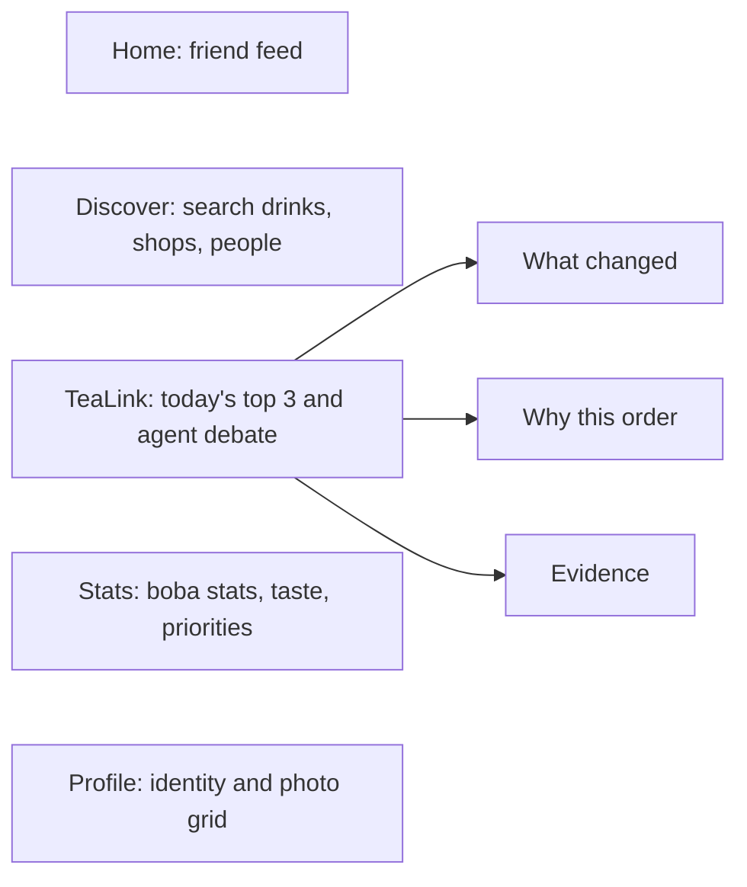
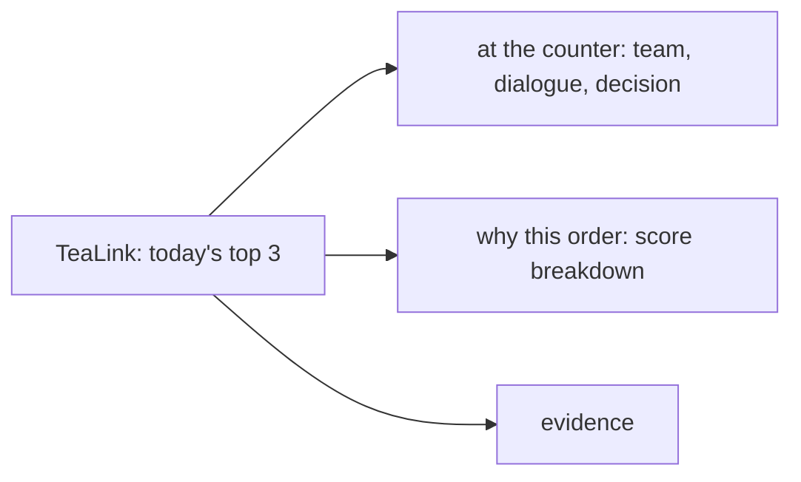

# TeaLink plan

*Living document, so anyone can edit it. Last edited Sun Oct 11, 10:00 AM. Mark status with ✅ done, 🟡 in progress, ⬜ not started, or ✂️ cut. Log what you finished in [`PROGRESS.md`](PROGRESS.md) and record plan changes in the log at the bottom.*

## Goal

**Cisco Cloud AI track, "When AI Agents Disagree."** We're targeting **Level 2 (Adaptive AI Team)**, plus two Level 3 pieces: a baseline comparison and an ask-the-human rule.

TeaLink is an explainable boba recommender. A team of agents with different goals argues over what you should order next. You get a top 3, you pick one, and the team learns what you care about.

## Key decisions

- **Agents** run on AGNTCY `agntcy-app-sdk`, using A2A over **NATS**. SLIM group chat is a stretch goal.
- **Fallback:** setting `TRANSPORT=local` runs the same agent classes in-process. This is the current default, and the demo never depends on the message bus.
- **Numbers come from code, never the LLM.** Scores, weights, vetoes, rankings, and the learned priorities are all computed in code. An LLM may only reword rationales (optional, through LiteLLM and the `LLM_MODEL` setting, with fixed template wording otherwise).
- **The user picks from a top 3** rather than getting a single answer. Each pick is a learning signal. *(Changed 12:50 PM.)*
- **Each agent has its own objective.** Every agent scores every candidate by its own objective, and the resolver blends those scores with weights learned for this user. No agent gets a casting vote. *(Changed 12:50 PM.)*
- **TeaLink is social.** Profiles, boba stats, follows, and a friends feed sit around the recommender, and a first-visit quiz seeds the Preference agent. See "Social layer" under the two-person split. *(Added 2:55 PM.)*
## Agent team

| Agent | Objective | Proposes? | Notes |
|---|---|---|---|
| Taste | Fit to the user's own reviews (`taste`) | Top 3 | Cites the user's reviews as evidence |
| Social | What the most similar users rated highly (`social`) | Top 3 untried, taste ≥ 0.5 | Similarity is the centered cosine of taste profiles. A drink nobody has rated scores neutral (0.5) |
| Explorer | Something new that's still a plausible fit (`novelty`) | Top 3 untried, taste ≥ 0.6 | |
| Budget | Cheapest that still fits (`cost`) | Top 3, taste ≥ 0.7 | |
| Shop (one per shop) | Inventory truth | No | Confirms stock or vetoes sold-out drinks. If a shop has no online agent, its drinks are dropped |
| Preference | Learns how much this user weighs each objective | No | Seeded from past picks (`data/choices.json`) and updated on every pick from the top 3 |

## Deliberation protocol

Schemas are in `backend/tealink/schemas.py`, mirrored in `frontend/src/api/types.ts`.

1. **Select.** The Concierge picks agents based on what their cards say they can do, and logs why it picked each one.
2. **Preference.** The Preference agent reports the user's current weights, for example taste 39%, price 42%, novelty 5%, and friends 14%.
3. **Propose.** Each objective agent proposes up to 3 drinks, each with evidence and a rationale.
4. **Object.** Every agent scores every candidate on its own objective. It supports a drink at 0.55 or above, raises a concern below 0.45, and is neutral in between. Shops veto anything sold out.
5. **Resolve.** The Concierge drops vetoed drinks and drinks with no confirming shop, then ranks the rest by the weighted sum of objective scores and returns the top 3. If the top two are within **0.02** of each other, or everything was ruled out, it sets `ask_human`.
6. **Learn.** `POST /choices` records the user's pick. The Preference agent nudges the weights toward the objectives where the pick beat the drinks the user passed over (learning rate 0.25, minimum weight 5%), then explains the change.
7. Every step streams to the frontend as a `LensEvent` over Server-Sent Events.

## How each Level 2 requirement is met

| Requirement | How | Status |
|---|---|---|
| Agents chosen by capability | Registry, agent cards, and the selection reasons the Concierge logs | ✅ |
| Unexpected change | A shop sells out (and vetoes the drink), or a shop goes offline (and its drinks are dropped) | ✅ |
| Dynamic discovery | Lantern Leaf registers a shop agent partway through a session | ✅ |
| Conflict resolution | The resolver blends objective scores with learned weights, plus an ask-the-human rule | ✅ |
| Explain who was selected and why | Lens timeline and the Why This page (score times weight, plus ruled-out drinks) | ✅ |
| New information changes the decision | User picks update the weights. Brown sugar dislike, sell-outs, and shop joins each trigger a fresh deliberation | ✅ |
| *Level 3:* baseline comparison | Popularity 2/24 hits, fixed weights 5/24, learning 7/24. `GET /eval` serves `eval_results.json` | ✅ |
| *Level 3:* ask the human | Near-tie or everything ruled out shows a prompt over the top 3 | ✅ |
| AGNTCY transport | `AgntcyTransport` over NATS | ✅ (go: demo flow passes on NATS, local stays the default) |

## Repo layout (current)

```
TeaLink/
  README.md  docs/PLAN.md  docs/PROGRESS.md  docs/architecture.md (todo)
  backend/
    tealink/
      schemas.py  config.py  llm.py
      data/seed.py  loader.py                 # writes backend/data/{shops,drinks,users,reviews,choices}.json
      core/taste.py  retrieval.py  similarity.py  objectives.py  preferences.py  resolution.py  baseline.py
           quiz.py  stats.py                  # onboarding quiz mapping, boba stats and personality
      social/store.py  # profiles, follows, feed (in memory, loaded from data/social.json)
      api/social.py    # /quiz, /users, /users/{id}[/follow|/followers|/following], /feed, /recs
      agents/objective_agent.py  taste_agent.py  social_agent.py  explorer_agent.py
             budget_agent.py  shop_agent.py  preference_agent.py  cards.py  roster.py  serve.py
      concierge/transport.py  registry.py  deliberation.py
      api/main.py      # /recommend (SSE), /choices, /preferences/{user}, /profile, /users/similar,
                       # /eval, /events/{sold-out,shop-join,shop-offline,preference,reset}
    eval/run_eval.py   # learning vs fixed weights on simulated users with hidden priorities
    tests/             # taste, resolution, preferences, end-to-end demo flow
  frontend/src/
    pages/Discover.tsx  WhyThis.tsx  Counterfactual.tsx  Friends.tsx
    components/TopChoices.tsx  PriorityBars.tsx  TasteBars.tsx  AgentTimeline.tsx  ControlPanel.tsx
    state/session.ts  api/client.ts  api/types.ts  mocks/sample_session.json
```

## Already done (Phases 0 to 2, plus most of 3)

- ✅ Skeleton, schemas and types, SSE gateway, seed data (6 shops, 43 drinks, users, reviews, and Andrew's past picks)
- ✅ All six agent kinds, capability selection, both rounds, the resolver, top 3, and the learning Preference agent
- ✅ Discover and Why This on live data, the timeline, and control panel buttons that re-run deliberation
- ✅ Sold-out, shop offline, shop joining mid-session, the preference flip, and ask-the-human
- ✅ **6:00 checkpoint met early:** real disagreement on screen, end to end

## Two-person split

The remaining work runs as two parallel tracks. **Track A** is the backend: agents, transport, and evidence. **Track B** is the frontend, demo, and write-ups. Each track owns its files outright, so the two of you don't block each other or hit merge conflicts. The default is Andrew on A and Emily on B; swap if you prefer.

### Ground rules

1. **First, together (1:15 to 1:30):** merge `feature/top3-preference-learning` into `main`. Both pull, and both confirm `make api` and `make web` run.
2. **Branches:** A works on `a/<topic>` and B works on `b/<topic>`. Open small PRs into `main`, merge at every sync point, and pull `main` right after.
3. **Shared files:** `schemas.py` and `types.ts` are the only shared files. A changes `schemas.py` and posts the diff in chat. B then mirrors it in `types.ts`. Neither of you changes the other's files.
4. **Never blocked:** B builds against mock JSON in `frontend/src/mocks/` that matches the contracts below. A tests with `pytest` and `curl`. The real data replaces the mocks once A merges.
5. **`PROGRESS.md`:** whoever merges a PR updates their own track's section.

### File ownership

| Track A owns (backend) | Track B owns (frontend, demo, docs) |
|---|---|
| `backend/tealink/**` (agents, core, concierge, api, data/seed) | `frontend/src/**` |
| `backend/eval/**`, `backend/tests/**`, `backend/data/*.json` | `frontend/src/mocks/**` (including mocks for A's upcoming endpoints) |
| `Makefile`, `docker-compose.yml`, `.env.example` | `docs/demo-script.md`, `docs/writeup.md`, the demo video |
| `docs/architecture.md` | `README.md` (A sends B notes on endpoints and setup) |

### Contracts to agree on now

So B can build the UI before A's backend is ready:

```ts
// GET /eval  (A serves backend/data/eval_results.json; B mocks frontend/src/mocks/eval.json)
type EvalResult = {
  rounds: number;
  methods: {
    method: "popularity" | "fixed_weights" | "learning";
    hit_rate: number;        // 0..1: the team's #1 was the drink the user picked
    top3_rate: number;       // 0..1: the pick was anywhere in the top 3
    sold_out_recs: number;   // how many recommendations were sold out
    repeat_rate: number;     // 0..1: share of recommendations the user had already tried
  }[];
  personas: {
    name: string;
    hidden_weights: Record<Dimension, number>;
    learned_weights: Record<Dimension, number>;
  }[];
};

// Stretch, only if A builds shop offers: a new optional field and a new event type
type Offer = { shop_id: string; percent: number; price_after: number; reason: string };
// RankedDrink.offer?: Offer | null      LensEventType adds "offer"
```

### Track A: backend, agents, evidence

| When | Task | Done when |
|---|---|---|
| 1:30 to 2:00 | ✅ **AGNTCY spike.** Get one Taste agent answering over NATS through `AgntcyTransport` (`docker compose up nats`, then `python -m tealink.agents.serve --agent taste`) | One `/recommend` with `TRANSPORT=agntcy` gets a Taste reply over NATS |
| **2:00** | **Go/no-go.** Go. Stay able to run `TRANSPORT=local`. B does not need a frontend change | |
| 2:00 to 3:30 | ✅ If go: serve every agent over NATS, run shop heartbeats over the bus, add `make agents`, and a startup fallback to local. If no-go: skip straight to the baseline | The demo flow passes on both transports |
| 3:30 to 5:00 | ✅ `core/baseline.py` (most-reviewed untried in-stock drink). Extend `eval/run_eval.py` to popularity vs fixed weights vs learning, write `eval_results.json`, and add `GET /eval` | `GET /eval` matches the contract, with a test |
| 5:00 to 6:00 | ✅ Story data fixes: tune Sarah's seed reviews so she's Andrew's top match, re-seed, and update the tests | `/users/similar?user_id=andrew` returns Sarah first |
| **6:00** | **Sync:** merge, then run the full demo together | |
| 6:30 to 8:00 | ✅ Stretch: **shop offers.** In a near-tie, the trailing shop's agent offers up to 10% off from its budget, but only when it is behind on price. The resolver re-scores the cost dimension, and an `offer` event is emitted | The offer can flip the #1. The scripted demo does not hit that case, so its numbers are unchanged |
| 8:00 to 9:00 | ⬜ Optional LLM wording for rationales (template fallback stays the default). Edge-case tests: all vetoed, no reviews, every shop offline | Tests pass with no API key set |
| **9:00** | **Merge.** Feature freeze at 9:30 | |
| Overnight | ⬜ `docs/architecture.md`: mermaid diagram, protocol, Level 2 mapping | |
| Sun 9:00 to 11:30 | Backend bug fixes; architecture and implementation sections of the write-up | |

### Track B: frontend, demo, write-ups

| When | Task | Done when |
|---|---|---|
| 1:30 to 3:00 | ✅ **Counterfactual page on live data.** Show a before/after of the top 3 using `previousDecision` and `decision` from the session store: what moved, what was ruled out, which event caused it, and the weight shifts | Clicking any control button, then opening Counterfactual, shows the real diff |
| 3:00 to 4:00 | ✅ Clean-up: update `sample_session.json` so the offline fallback shows the top 3 and priorities; delete `RecommendationCard.tsx`; point Friends at `/users/similar` (or hide the tab) | `npm run build` and lint pass; the app still works with the API stopped |
| 4:00 to 6:00 | ✅ **Evidence page** (`/evidence`) built against `mocks/eval.json`: a methods table, hit-rate bars, and hidden vs learned weights per persona | Renders from the mock, then switches to `GET /eval` after A merges |
| **6:00** | **Sync:** merge, then run the full demo together | |
| 6:30 to 7:30 | ✅ Ask-the-human polish: when `ask_human` is set, the prompt names both options and what separates them, and the pick resolves it. Timeline readability (group by round, collapse selection events) | A judge can follow one run without explanation |
| 7:30 to 9:00 | 🟡 `docs/demo-script.md` (written and checked against the API; dry runs and the offer badge are left) (exact clicks and lines, 3 minutes). If A builds offers, add an offer badge on cards and an `offer` timeline style | Two dry runs from a reset |
| **9:00** | **Merge.** Feature freeze at 9:30 | |
| Sun 9:00 to 11:30 | UI polish; results and lessons sections of `docs/writeup.md`; record the backup demo video | |

### Social layer (added 2:55 PM)

**Goal:** TeaLink should feel like a social app, not a tool. Users follow each other, react to what friends drink, show off their boba stats on a profile they customize, and get personalized from their very first visit through a short quiz.

**Inspiration, borrowing one idea from each:**
- **Instagram:** a profile header (avatar, name, bio, follower counts), a grid of drinks tried, and a bottom tab bar on phones.
- **Letterboxd:** log and rate drinks, with short reviews friends can like and comment on.
- **Spotify Wrapped:** a bold, shareable "Boba card" of your stats.
- **Strava:** a friends feed of activity ("Sarah tried Osmanthus Milk Tea, 5/5") with quick reactions.
- **BuzzFeed / 16Personalities:** a fun onboarding quiz that ends in a named "boba personality."

**Features:**
1. **Onboarding quiz** (6 questions, under a minute) for new users:
   - **Questions:** sweetness level, milk vs fruit vs tea-forward, toppings, flavors you like (multi-select over the `drinks.json` flavor tags), typical budget, and how adventurous you are. The exact questions and option ids are in `frontend/src/mocks/social/quiz.json`; A can serve that file from `GET /quiz` as is.
   - **Results:** your starting taste profile, your starting priority weights for the Preference agent, and a boba personality, such as "Floral Explorer" or "Brown Sugar Loyalist."
   - **Rule:** like every other number in TeaLink, the backend computes the mapping from answers to profile and weights in code.
2. **Boba stats:**
   - favorite drink and favorite store;
   - sweet vs not sweet;
   - go-to toppings;
   - milk vs fruit split;
   - drinks tried and shops visited;
   - a weekly streak;
   - top taste notes;
   - the learned priority mix ("cares most about price").
   Each stat has a show/hide toggle, so the user chooses what's public.
3. **Customizable profile:**
   - display name, @handle, and bio;
   - avatar (an emoji plus a background color, so no image uploads);
   - a pinned favorite drink and store;
   - a profile accent color;
   - which stats to show, and in what order.
4. **Interacting with other users:**
   - follow and unfollow;
   - a friends feed of reviews and picks;
   - likes and short comments;
   - "send a rec" to a friend;
   - "% taste match" on every profile (reuses the existing similarity code).

**Ground rules:**
- **The demo stays safe.** Andrew (the demo user) is already onboarded, so the 3-minute demo doesn't depend on any social feature. Reset demo also restores the social seed data.
- **No real accounts.** "Signing up" just picks a handle, and the user id is kept in `localStorage`. Social data lives in JSON files and in memory, like picks do today.
- **How it ties into the agents:**
  - The quiz solves the Preference agent's cold start: it gives a new user non-default weights from round one.
  - Follows can optionally feed the Social agent (people you follow count a little more).

**Contracts** (A adds these to `schemas.py`; B mirrors them in `types.ts` and builds against mocks first):

```ts
type StatKey = "fav_drink" | "fav_shop" | "sweetness" | "toppings" | "milk_vs_fruit"
             | "tried_count" | "shops_visited" | "streak" | "top_notes" | "priorities";

type BobaStats = {
  fav_drink_id: string | null; fav_shop_id: string | null;
  sweetness: number;                  // 0 = not sweet, 1 = very sweet
  toppings: number;                   // 0 = no toppings, 1 = loaded (the drinks' `toppings` attribute)
  milk_vs_fruit: number;              // 0 = fruit, 1 = milk
  tried_count: number; shops_visited: number; streak_weeks: number;
  top_notes: string[];                // flavor tags from drinks.json, e.g. ["brown_sugar", "oolong"]
  priorities: Record<Dimension, number>;
  personality: string;                // "Floral Explorer"
};

type UserProfile = {
  user_id: string; handle: string; display_name: string; bio: string;
  avatar: { emoji: string; color: string }; accent: string;
  pinned_drink_id: string | null; pinned_shop_id: string | null;
  visible_stats: StatKey[];           // in display order; hidden stats are left out
  followers: number; following: number; followed_by_me: boolean;
  taste_match: number | null;         // 0..1 vs the viewer
  stats: Partial<BobaStats>;          // only the visible stats for other viewers
};

type QuizQuestion = { id: string; prompt: string; options: { id: string; label: string; emoji?: string }[]; multi?: boolean };
type QuizResult = { user_id: string; personality: string; stats: BobaStats; weights: Record<Dimension, number> };

type Author = { handle: string; display_name: string; avatar: { emoji: string; color: string } };

type FeedItem = {
  id: string; user_id: string; author: Author; kind: "review" | "pick" | "rec" | "joined";
  drink_id: string | null; rating: number | null; text: string | null;
  to_user_id?: string; to_author?: Author;   // recs only
  created_at: string; likes: number; liked_by_me: boolean;
  comments: { id: string; user_id: string; author: Author; text: string; created_at: string }[];
};
```

**Endpoints (A):**
- **Quiz and sign-up:**
  - `GET /quiz` returns the questions.
  - `POST /users` takes `{handle, display_name}`, creates a user, and returns the profile.
  - `POST /quiz` takes `{user_id, answers}` (question id → chosen option ids) and returns a `QuizResult`. It also seeds the Preference agent.
- **Profiles:**
  - `GET /users?viewer=` returns `UserProfile[]` of everyone else, best taste match first (for "Suggested for you").
  - `GET /users/{id}?viewer=` returns a `UserProfile`. `{id}` may be a user id or a handle.
  - `PATCH /users/{id}` saves profile edits.
  - `POST /users/{id}/follow` and `DELETE /users/{id}/follow` take `{viewer}`.
- **Feed:**
  - `GET /feed?user_id=` returns the viewer's feed: their own posts, people they follow, and recs sent to them, newest first. Adding `&author=` returns only that author's posts (for profile pages).
  - A missing user or item returns 404 with a specific `detail`, not FastAPI's default "Not Found". The frontend treats "Not Found" as "route not shipped yet" and falls back to mocks.
  - `POST /feed/{id}/like` likes an item and `DELETE /feed/{id}/like` unlikes it. Both take `{viewer}` and return the updated `FeedItem`.
  - `POST /feed/{id}/comments` takes `{viewer, text}` and returns the updated `FeedItem`.
  - `POST /recs` takes `{from, to, drink_id, text}` to send a recommendation.

The existing `GET /profile/{id}` (taste profile) stays as it is.

#### Track A: social backend

| When | Task | Done when |
|---|---|---|
| 3:00 to 4:00 | ✅ Schemas above in `schemas.py`; seed social data for the existing users (handles, bios, avatars, follows, a few feed items from real reviews); Reset demo restores it | Seed loads, and `GET /users/sarah?viewer=andrew` returns a full profile |
| 4:00 to 5:00 | ✅ `core/stats.py`: boba stats and personality from reviews and picks. Quiz questions and the answer → taste profile + weights mapping (`core/quiz.py`), unit-tested | `POST /quiz` returns stats and weights; a new user's first `/recommend` uses those weights |
| 5:00 to 6:00 | ✅ Profile, follow, feed, like, comment, and rec endpoints; picks and reviews post feed items; visibility respected for other viewers | Tests cover hidden stats, follow counts, and feed order |
| 8:00 to 9:00 | ⬜ Optional: Social agent gives a small boost to people the user follows (replaces the LLM wording block if time is short) | The boost shows up in the Social agent's evidence |

#### Track B: social frontend

| When | Task | Done when |
|---|---|---|
| 3:00 to 4:00 | ✅ Mirror the contracts in `types.ts`, mocks in `frontend/src/mocks/social/`, client calls with mock fallback. App shell: bottom tab bar on phones (Home, Discover, Profile), top nav on desktop | Every new screen renders from mocks with the API stopped |
| 4:00 to 5:00 | ✅ **Onboarding quiz** at `/welcome`: one question per screen, big tappable option cards, progress bar, then a personality reveal and a "Boba card" (Wrapped-style). New visitors without a user id land here | Finishing the quiz creates a user and opens Discover with their own weights |
| 5:00 to 6:00 | ✅ (done early) **Profile page** at `/u/:handle`: Instagram-style header, stats grid, pinned drink and store, drinks-tried grid, taste match, follow button. **Edit profile** sheet: name, bio, emoji avatar and color, accent, show/hide and reorder stats | Edits and hidden stats persist after a reload |
| **6:00** | **Sync:** merge, then run the full demo plus the quiz once | |
| 6:30 to 8:00 | ✅ **Home feed**: friend activity cards, likes, comments, "send a rec," and "Try this" that opens Discover. Fold the current Friends page into profiles and follow lists | Liking and commenting work on two users in two tabs |
| 8:00 to 9:00 | 🟡 (offer badge done) Offer badge if A built offers (from the earlier block); demo script gains an optional 20-second "social" beat (quiz → profile → feed) | Main demo still fits in 3 minutes without the social beat |

**If time runs short, cut in this order:** comments and recs, then the feed, then stat reordering. **Keep:** the quiz and the profile with stats toggles.

### UI cleanup and five tabs (added 3:30 PM)

**Goal:** Every screen is easy to read at a glance. The app is organized into five clear tabs, and drinks, reviews, and profiles have pictures.

**Five tabs.** The same five tabs appear in the bottom bar on phones and the top nav on desktop:
- **Home** (`/home`): the friends feed.
- **Discover** (`/discover`): browse and search drinks, shops, and people, with filter chips (milk, fruit, or tea; under $5; flavor tags). Tapping a drink opens a detail sheet with its photo, shop, price, and friends' ratings.
- **TeaLink** (`/`, the center tab): today's picks.
  - This is the current agent recommender, reframed as "today's top 3": the close call, the debate, What changed, and Why this order.
  - What changed, Why this order, and Evidence become links inside this tab instead of items in the main nav.
  - It stays at `/`, so the demo URL and `docs/demo-script.md` don't change.
- **Stats** (`/stats`): your own stats.
  - The boba stats grid, taste profile, and learned priorities.
  - The Wrapped-style Boba card.
  - Stat visibility settings.
- **Profile** (`/u/:handle`): identity and posts.
  - Cover, avatar, bio, and personality.
  - A compact row of stat highlights that links to Stats.
  - Go-to order.
  - An Instagram-style photo grid of reviews.

The current Friends page folds into Discover (the people results) and profiles.



**Readability rules for every screen:**
- **Layout:** one main column, at most about 640px wide on phones, with one primary action per screen.
- **Type:** a consistent scale of page title, section title, body, and caption. Body text is at least 15px, and muted text still passes contrast.
- **Fewer boxes inside boxes:** sections are separated by spacing and headers, not nested cards.
- **Touch and states:** tap targets are at least 44px, and every list has a clear empty, loading, and error state.
- **TeaLink timeline:** the agent timeline is collapsed by default behind "See how the agents decided." During the demo it opens with one tap.

**Pictures (placeholders now, uploads later):**
- **Drinks:** about 10 generated images, one per drink style:
  - classic milk tea, brown sugar, fruit tea, matcha, taro;
  - Thai tea, hojicha, floral or oolong, horchata or ube, coffee.
  Each drink maps to one by its flavor tags. Stored in `frontend/public/img/drinks/`.
- **Shops:** 6 generated storefront images in `frontend/public/img/shops/`.
- **Profiles:** about 6 generated cover images to choose from in Edit profile.
- **Where they appear:** review cards in the feed, drink cards on TeaLink and Discover, the profile photo grid, the profile cover, and the Discover detail sheet.
- **Future uploads:** the contract reserves photo fields that stay `null` for now. When a URL is present, it replaces the placeholder, so adding real uploads later needs no frontend change.

**Contract additions** (A adds them; B mirrors them in `types.ts`):

```ts
// All optional and null for now; the frontend falls back to placeholders.
FeedItem.photo_url?: string | null;      // a review photo, for future uploads
UserProfile.cover_url?: string | null;   // a chosen placeholder id, or an uploaded image URL later
// GET /drinks -> { id, name, shop_id, price, flavor_tags, photo_url }[]  (replaces the frontend's copied catalog)
// GET /shops  -> { id, name, neighborhood, photo_url }[]                  // 6 shops, including Lantern Leaf
```

Search runs in the browser over `GET /drinks`, the shop list, and `GET /users`. The data is small (43 drinks, 6 shops, 15 users), so no search endpoint is needed.

#### Track A: UI cleanup support

| When | Task | Done when |
|---|---|---|
| 5:00 to 6:00 (or earlier, since the social endpoints are done) | ✅ `GET /drinks` and `GET /shops`, plus the reserved `photo_url` on feed items and `cover_url` on profiles | `GET /drinks` returns all 43 drinks, `GET /shops` returns all 6, and the new fields come back as `null` |
| After the freeze | ⬜ Stretch: a photo upload endpoint for review and profile photos | An uploaded photo's URL comes back in `photo_url` / `cover_url` |

#### Track B: UI cleanup

This reshuffles B's remaining evening; the earlier Track B social rows keep their tasks but follow this order.

| When | Task | Done when |
|---|---|---|
| 4:00 to 5:00 | ✅ Onboarding quiz and Boba card (unchanged) | See the social-frontend table |
| 5:00 to 6:00 | ✅ Five-tab navigation and routes; the TeaLink tab links to What changed, Why this order, and Evidence; Friends folded in | Every tab works on phone and desktop, and the demo script still runs from `/` |
| **6:00** | **Sync:** merge, then run the full demo plus the quiz once | |
| 6:30 to 7:30 | ✅ Generate the placeholder images; Discover with search, filters, and the drink detail sheet | Searching "matcha" finds drinks, shops, and people |
| 7:30 to 8:30 | 🟡 (Stats tab, photos, and the collapsed timeline are done; the older pages still need the readability pass) Stats tab, then a readability pass across all tabs; photos on review cards and the profile grid | Every screen follows the readability rules above |
| 8:30 to 9:00 | ✅ Feed leftovers ("send a rec") and the offer badge, if A built offers | |

### UI round 2 and agent dialogue (added 6:55 PM)

**Goal:**
- The TeaLink tab shows only today's top 3, and the agent story gets its own sub-tab.
- The agents genuinely respond to each other's objections, and the timeline reads like a group chat.
- Stats and Discover are trimmed to what matters.

**General (both tracks):**
- **Transitions:** clean transition animations between every tab, sub-tab, and section.
- **Always "you":** all copy speaks to the user as "you" ("your taste", "what matters most to you"). Never use the user's name ("Bob's taste") or "the user."
  - Track B fixes the copy written in the frontend.
  - Track A fixes the text the backend writes: preference summaries, decision explanations, counterfactual notes, and offer reasons.

**New TeaLink sub-tabs:** today's picks · at the counter · why this order · evidence. **What changed is removed.**



**Customer side:**
- **TeaLink, today's picks:**
  - The top 3 cards lose their four meters (taste match, price, something new, people like you). That breakdown lives only in why this order.
  - Remove "what you care about" and "my taste"; both are already in Stats.
  - Remove "people with your taste"; that belongs in Discover.
- **At the counter (new sub-tab):** it moves out of today's picks.
  - **Agent symbols:** each core agent gets its own minimal line symbol, matching the doodle style. Every shop agent shares one shop symbol.
  - **Team selected:** a grid of agent icons replaces the list of names. Tapping an icon expands it to show the agent's name, symbol, and description.
  - **They argue:** shown as a group chat. Messages are grouped by round, concessions are visible ("Budget softens on Thai Tea"), and the last line says who decided: the agents agreed, the arbiter decided, or you picked.
  - **The what-if demo controls** (#1 sells out, shop offline, Lantern Leaf joins, no brown sugar, Reset demo) move here. They now sit on what changed, which is being removed.
- **Stats:**
  - **Boba card background:** you choose the color yourself.
  - **"What matters most" → "what matters most to you":** no percentage.
  - **All stats:**
    - Remove toppings, milk vs fruit, and sweet vs not sweet.
    - Combine boba streak, shops visited, and drinks tried into one section.
    - Lay out everything below the card in a receipt-style format.
- **Discover:**
  - **Drink filters:** no repeats, so "fruit tea" and "fruit" merge into one chip.
  - **Order:** shops and drinks are ordered from closest match to least match for you.

**Agent dialogue (soften-only rebuttal rounds):**
- **Rounds:** after the objection round, the gateway relays every agent's objections to all agents, which may then revise their stances. This repeats up to **3 rounds**.
- **Soften-only:** after round 1, an agent may only soften: concede, drop a concern, or lower its confidence. It never hardens a stance, so the dialogue always settles.
- **Vetoes:** shop vetoes (sold out) stay binding and are never softened.
- **The gateway only relays:**
  - It stops early when no agent changes anything in a round.
  - At the cap, or if an agent times out, it runs the existing `resolve()` on everyone's latest scores. It never restarts.
- **Who decided:**
  - "the agents agreed" if the dialogue settled before the cap.
  - "the arbiter decided" if it hit the cap or a timeout.
  - The existing near-tie question to you still runs after that. If you pick, the timeline says "you picked."
- **Setting:** `DELIBERATION=dialogue|single`. `single` is today's two-round behavior and stays the demo fallback. The `/health` response reports which mode is on.
- **Demo numbers:** with `single`, they must not change. With `dialogue`, A re-checks the scripted run and reports any new numbers in `PROGRESS.md`.

**Contract additions** (A adds them; B mirrors them in `types.ts`):

```ts
// On "proposal" and "objection" events. Round 1 is the first objection round.
LensEvent.payload.round?: number;
// On objection events where an agent softened its stance this round.
LensEvent.payload.revised_from?: { kind: "support" | "concern" | "neutral"; score: number | null };
// On the "decision" event. "you picked" is added by the frontend when the user breaks a near-tie.
Decision.decided_by?: "agents" | "arbiter";
Decision.rounds?: number;              // rebuttal rounds that ran (0 in single mode)
// On "selection" events, so the team grid can show them without a second request.
AgentSelection.name?: string;
AgentSelection.description?: string;
// GET /health
Health.deliberation?: "dialogue" | "single";
// Match scores for Discover ordering (or a sorted list per user; A's choice)
// GET /drinks?user={id} -> each drink gains match: number (0–1)
// GET /shops?user={id}  -> each shop gains match: number (0–1), its best drink's match
// PATCH /users/{ref} accepts card_color: string; UserProfile.card_color?: string
```

#### Track A: UI round 2 and dialogue

| Order | Task | Done when |
|---|---|---|
| 1 | ✅ Second-person text in everything the backend writes (preference summaries, explanations, counterfactual and offer text) | No backend message uses the user's name or "the user" |
| 2 | ✅ `name` and `description` on selection events; `match` on `GET /drinks` and `GET /shops` for a user; `card_color` on `PATCH /users` | The team grid and Discover ordering work with no extra requests |
| 3 | ✅ `DELIBERATION=dialogue\|single` with soften-only rebuttal rounds (cap 3), early stop when nothing changes, and arbiter fallback on cap or timeout | In `single` mode the demo numbers are unchanged. In `dialogue` mode, events carry `round` and `revised_from`, and the decision carries `decided_by` and `rounds` |
| 4 | ✅ Re-check the scripted demo in `dialogue` mode and report the numbers in `PROGRESS.md` | B can update `demo-script.md` |

#### Track B: UI round 2

| Order | Task | Done when |
|---|---|---|
| 1 | ✅ TeaLink: new sub-tabs (today's picks · at the counter · why this order · evidence); remove what changed; move the what-if controls to at the counter; strip the top 3 meters and the three extra sections | Today's picks shows only the top 3, and the demo runs from the at the counter sub-tab |
| 2 | ✅ At the counter: agent symbols, team icon grid with tap-to-expand, and "they argue" as a group chat grouped by round, with concessions and who decided | Readable in both `single` and `dialogue` mode (in `single`, it shows one round and "the arbiter decided") |
| 3 | ✅ Stats: card color picker, "what matters most to you" without a percentage, trimmed and combined stats, receipt layout | |
| 4 | ✅ Discover: deduplicated drink filters, and match ordering for shops and drinks | Your closest match is first in both lists |
| 5 | ✅ "You" copy pass across all frontend text, and transition animations everywhere | |
| 6 | ✅ Update `docs/demo-script.md` for the new sub-tabs (Reset demo and the what-if buttons now live in at the counter) | The script's clicks match the app |

### Accounts, store tools, and ordering (added 8:15 PM)

**Goal:**
- Real accounts: you sign in to get into the app, and you can sign back in to the same account from any browser.
- Shops run their own page: menu, discount rules, demand trends, and their shop profile.
- You can order and pay for a drink from a shop, and the shop sees the order.

**General:**
- **No default profile before sign in.**
  - Today `state/me.ts` falls back to the demo user (`andrew`) when nothing is stored, so some screens can show Andrew's data before anyone signs in.
  - After this change there is no current user until you sign in or sign up. Nothing personal renders before that.
  - The demo still needs a one-tap way in, so the sign-in screen keeps **"use the demo account"** buttons (Andrew as a customer, and Sunright Tea Studio as a shop). They sign in to real seeded accounts; they are not a silent fallback.

**Customer side:**
- **Accounts with sign in:**
  - Users, shop accounts, and sessions live in a database (SQLite is enough). The social profiles and choices that are in JSON today move into it, or link to it by `user_id`.
  - Sign up takes email (or handle) and a password, then runs the existing quiz. Sign in restores that account on any browser. Log out ends the session.
  - Passwords are hashed (bcrypt or argon2), never stored or logged in plain text. Sessions use an httpOnly cookie or a bearer token.
  - Seeded users get a demo password so the demo accounts can sign in.
- **No access without an account:**
  - Every customer and shop route sends you to `/welcome` (sign in or sign up) until you have a session.
  - The API takes the user from the session, not from a `user_id` in the request, for everything that writes data or reads private data. The public catalog (`GET /drinks`, `GET /shops`) can stay open.
- **Buying drinks from shops:**
  - **Order for pickup** on today's picks cards, the drink sheet in Discover, and a shop's menu.
  - Choose sugar, ice, and toppings from the shop's menu options. One shop per order.
  - **Checkout:** the price, any close-call offer you were shown (applied only before it expires, and only for that drink), and the pickup fee.
  - **Payment:** Stripe in test mode, with the secret key on the server only. The browser never sees a secret key or raw card numbers. "Pay at pickup" is the fallback, and it is what the demo uses if Stripe isn't set up.
  - **Order status:** placed → accepted → ready → picked up. You see it on an Orders page. The shop sees incoming orders and moves them along.
  - A completed order counts as a pick for the Preference agent, and afterwards you're asked to rate the drink.

**Shops side:**
- **Menu editing:**
  - Add, edit, and remove drinks: name, price, photo, description, flavor tags, taste attributes (sliders), and the sugar, ice, and topping options.
  - Add, rename, reorder, and remove **menu sections** (for example "milk teas", "fruit teas", "seasonal"), and move drinks between them.
  - Sold out and restock reach the recommender. Today they're saved only in that browser.
- **Close-call discount rules:**
  - The four current rules (runner-up, within 0.02, a different shop, losing on price) become **platform rules**. They're shown with a lock and can't be removed, so a shop can never buy a win outside a close call.
  - The shop adds, edits, and removes its **own rules** on top, from a fixed set of rule types with settings: max percent and max dollars (never above the platform cap), which drinks or sections, which days and hours (for example off-peak only), and max offers per day.
  - An offer goes out only when the platform rules and every one of the shop's rules hold. The offer is computed in code. An LLM never sets the number. Offers stay labelled on the cards.
- **Taste trends in Demand:**
  - What kinds of drinks people choose (milk tea, fruit tea, tea-forward, and top flavors), the most popular drinks overall and the shop's own, and how the priorities people weigh are shifting.
  - Toggle between **past week, past month, and past year**.
  - Built from choices, orders, and reviews, anonymized and aggregated. Buckets with fewer than 5 people are hidden, and no names are shown.
  - The seed adds timestamps across the past year so all three ranges have data.
- **Shop profile:** change the shop picture and add a description. Both show on Discover's shop cards and the shop's page.

**Demo safety:**
- The scripted demo must still run exactly as written. You sign in with the demo button, and Reset demo returns menus, rules, sold-out marks, and orders to the seed without deleting accounts.
- The single-mode demo numbers must not change: Thai Tea 78, Wintermelon 77, Pearl 71.

**Contract additions** (A adds them; B mirrors them in `types.ts`):

```ts
// Auth. Session cookie (httpOnly) or bearer token; A picks one and notes it in PROGRESS.md.
POST /auth/signup   { email, password, role: "customer" | "store", shop_id? } -> { user_id, role, shop_id? }
POST /auth/login    { email, password } -> { user_id, role, shop_id? }
POST /auth/logout   -> { ok: true }
GET  /auth/me       -> { user_id, role, shop_id? } | 401

// Menu
GET    /shops/{id}/menu -> { sections: { id, name, order, drink_ids: string[] }[] }
PUT    /shops/{id}/menu/sections                { sections: { id?, name, order, drink_ids }[] }
POST   /shops/{id}/drinks                       DrinkInput -> Drink
PATCH  /shops/{id}/drinks/{drink_id}            Partial<DrinkInput & { available: boolean }> -> Drink
DELETE /shops/{id}/drinks/{drink_id}
// DrinkInput: { name, price, description?, photo_url?, flavor_tags, attributes, options?: { sugar: string[]; ice: string[]; toppings: { name, price }[] } }

// Discount rules (platform rules are read-only)
GET    /shops/{id}/offer-rules -> { platform: { id, text }[]; rules: OfferRule[]; cap: { percent, dollars } }
POST   /shops/{id}/offer-rules                  OfferRuleInput -> OfferRule
PATCH  /shops/{id}/offer-rules/{rule_id}        Partial<OfferRuleInput> -> OfferRule
DELETE /shops/{id}/offer-rules/{rule_id}
// OfferRule: { id, kind: "max_discount" | "drinks" | "sections" | "hours" | "days" | "daily_limit", value, enabled }

// Demand
GET /shops/{id}/demand?range=week|month|year
  -> { bases: { base, share }[]; flavors: { tag, share }[]; top_drinks: { drink_id, count }[];
       own_top_drinks: { drink_id, count }[]; priorities: DimensionScores; people: number }

// Shop profile
PATCH /shops/{id} { description?, photo_url? } -> Shop   // GET /shops gains description

// Orders
POST  /orders { shop_id, items: { drink_id, sugar?, ice?, toppings?: string[] }[], offer_id?, pay: "card" | "pickup" }
        -> { order_id, total, status: "placed", payment_url? }
GET   /orders            -> Order[]   // yours as a customer; the shop's incoming ones as a store
PATCH /orders/{id}       { status: "accepted" | "ready" | "picked_up" | "cancelled" } -> Order
```

#### Track A: accounts, store tools, and ordering

| Order | Task | Done when |
|---|---|---|
| 1 | ✅ Database plus auth: users, shop accounts, hashed passwords, sessions, and `/auth/*`; seed demo passwords | The demo accounts sign in. Private endpoints return 401 without a session and read the user from it |
| 2 | ✅ Menu and shop profile: drinks CRUD, menu sections, shop `description` and `photo_url`; sold out from the shop menu reaches the recommender | An edited price or a new drink shows up in the next recommendation |
| 3 | ✅ Offer rules: platform rules locked, shop rules CRUD, and the offer engine checks both | A shop rule can stop an offer but never allows one outside a close call or above the cap. Demo numbers unchanged |
| 4 | ✅ Demand trends over week, month, and year from choices, orders, and reviews, with timestamps in the seed | Each range returns data, and small buckets are hidden |
| 5 | ✅ Orders: create, status changes, offers applied at checkout, Stripe test mode with pay at pickup as the fallback; a completed order teaches the Preference agent | A demo order goes from placed to picked up, and the shop sees it |
| 6 | ✅ Reset demo restores menus, rules, sold-out marks, and orders, but keeps accounts | The scripted demo runs twice in a row unchanged |

#### Track B: accounts, store tools, and ordering

Andrew wrote the first shop pages in `frontend/src/pages/shop/`. B builds on them; tell A before reworking them.

| Order | Task | Done when |
|---|---|---|
| 1 | ✅ Sign in and sign up on `/welcome` with "use the demo account" buttons; remove the default profile in `state/me.ts`; every customer and shop route requires a session | A fresh browser sees only `/welcome` until it signs in, and signing in elsewhere restores the same account |
| 2 | ✅ Shop menu editor: drinks (add, edit, remove, sold out), sections (add, rename, reorder, move drinks) | A shop can build a section and move a drink into it |
| 3 | ✅ Close-call discount rules page: locked platform rules, plus the shop's own rules to add, edit, remove, and switch on or off | Changes save to the API and survive a reload |
| 4 | ✅ Demand: taste trends with a week, month, and year toggle (drink types, flavors, most popular overall and the shop's own) | All three ranges render, with no names shown |
| 5 | ✅ Shop profile: change the picture and add a description; show them on Discover's shop cards | The new picture and description show on Discover |
| 6 | ✅ Ordering: Order for pickup, options, checkout (offer and pickup fee), payment or pay at pickup, an Orders page with status, and the shop's incoming orders | A demo order completes end to end |
| 7 | ✅ Update `docs/demo-script.md` for sign in, and add a short shop-side moment if there's time | The script's clicks match the app |

All seven run on in-browser mocks until Track A's routes land, and switch to the API with no frontend change. The differences A should know about are in `PROGRESS.md`.

### Custom what-if at the counter (added 8:20 PM)

**Goal:** the what-if box on at the counter takes your own changes, not just the five preset buttons. You describe a change, and the agents re-plan around it.

**How it works:**
- **A change builder:** pick the kind of change, then the target from lists of real drinks, shops, and flavors. Kinds:
  - a drink sells out, or is back in stock;
  - a shop goes offline, comes back online, or joins;
  - you don't want a flavor or ingredient, or you want more or less of a taste (sweeter, less milky, more tea);
  - a price limit for this order;
  - a drink's price changes.
- **Or type it:** a text box such as "taro is sold out at boba guys" or "I want something less sweet under $6."
  - The backend turns the text into the same structured changes the builder makes, and the UI shows them as chips ("Taro Milk Tea: sold out", "sweetness: lower", "under $6.00") for you to confirm or remove before anything runs.
  - An LLM may do the parsing, but it can only choose from the known change kinds and real ids. Anything it can't match is shown as "not understood" and is never applied. Without an LLM key, a simple keyword matcher does the same job.
  - The LLM never sets scores. Scores and rankings stay in code.
- **Several changes at once:** you can stack changes, and one re-plan runs for all of them.
- **The chat shows them:** each applied change appears as a note at the top of "they argue" ("You: taro is sold out at Boba Guys"), as the preset buttons do now.
- **The presets stay:** #1 sells out, #1's shop goes offline, Lantern Leaf joins, no brown sugar, and Reset demo remain as one-tap chips, so the demo script doesn't change.
- **Reset demo** clears every custom change.

**Contract additions** (A adds them; B mirrors them in `types.ts`):

```ts
type WhatIf =
  | { kind: "sold_out" | "restock"; drink_id: string }
  | { kind: "shop_offline" | "shop_online" | "shop_join"; shop_id: string }
  | { kind: "avoid"; tag: string }                                   // flavor or ingredient, e.g. "brown_sugar"
  | { kind: "taste"; attribute: TasteAttribute; direction: "more" | "less" }
  | { kind: "max_price"; dollars: number }                           // this order only
  | { kind: "price"; drink_id: string; dollars: number };

POST /whatif/parse { text } -> { changes: WhatIf[]; not_understood: string[] }
POST /whatif       { user_id, changes: WhatIf[] } -> { ok: true; applied: WhatIf[] }   // then the frontend re-runs /recommend
```

#### Track A: custom what-if

| Order | Task | Done when |
|---|---|---|
| 1 | ✅ `POST /whatif` applies the structured changes, including the new kinds (restock, shop back online, taste direction, a price limit for this order, a price change); Reset demo clears them | Each kind changes the next recommendation, and the preset buttons give the same numbers as before |
| 2 | ✅ `POST /whatif/parse`: text to changes, limited to the known kinds and real ids, with a keyword fallback when there's no LLM key | "taro is sold out at boba guys" is not a real drink there, so it comes back as not understood. Nonsense returns only `not_understood` |

#### Track B: custom what-if

| Order | Task | Done when |
|---|---|---|
| 1 | ✅ Change builder on at the counter: kind, then target from real lists; stack several; apply runs one re-plan | A custom sold-out and a taste change both show up in the chat and the new top 3 |
| 2 | ✅ Text box: parse, show the changes as chips to confirm or remove, and show what wasn't understood | Nothing runs until you confirm |
| 3 | ✅ Keep the five presets as chips, and make sure the demo script still matches | The scripted demo is unchanged |

Until `POST /whatif` is served, the frontend applies sold out, shop offline, shop joins or back online, avoid, and taste through the existing event routes. Restock, a price limit, and a price change are listed as "not applied yet". Until `POST /whatif/parse` is served, the same keyword matcher runs in the browser (`frontend/src/lib/whatif.ts`).

### Ordering replaces picking, custom posts, and besteas (added 9:30 PM)

**Goal:** ordering is the only way to choose a drink, orders stay private unless you choose to share, people post what they want, and close friends ("besteas") can follow each other's orders.

**Customer side:**
- **Order, don't pick:**
  - "Pick this" is removed from the top 3 cards, and the close-call buttons ("I'd take Thai Tea") become "Order Thai Tea". Both open the order sheet.
  - Placing an order for a drink from your current top 3 is the pick: the Preference agent learns from it right away, the same way "Pick this" did, and the round re-runs. Learning moves from pickup to placement so the demo doesn't wait on the shop. A later pickup doesn't teach it twice, and cancelling doesn't undo it.
  - An order for a drink that isn't in your top 3 (for example from Discover) counts as a taste signal instead. It nudges your taste profile toward that drink, like a good review, and counts toward drinks tried. It doesn't change your priority weights: with no passed-over options to compare against, there's no way to tell whether you chose it for taste, price, novelty, or a friend.
- **No automatic posts:** ordering (or the old pick route) no longer adds a "pick" item to your profile or anyone's feed. The seeded "pick" posts are removed from the feed; they still count as order history.
- **Your own posts:**
  - A photo with a caption (like an Instagram post), or just a caption (like a tweet).
  - You can tag a drink or a shop. Likes and comments work as they do on reviews.
  - Posts show in followers' feeds and on your profile: photo posts in the grid, and every post in the list view. You can delete your own.
- **Past orders on your profile:**
  - A "past orders" stat: your recent orders (drink, shop, and date; never prices), newest first.
  - It's one more stat in Edit profile, so you can show it, hide it, or reorder it like the others. Other viewers only see it when it's shown.
- **Besteas:**
  - A "Request bestea" button next to Follow on someone's profile. They accept or decline. Either of you can end it at any time.
  - Besteas get a notification whenever the other places an order: "Sarah ordered Hojicha Cream Tea at Sunright Tea Studio."
  - A bell in the header shows unread notifications: bestea requests (with accept and decline), accepted requests, and bestea orders.

**Demo safety:**
- The single-mode numbers must not change: Thai Tea 78, Wintermelon 77, Pearl 71 after Reset demo.
- The script's "Pick Pearl Milk Tea" step becomes "Order Pearl Milk Tea" (pay at pickup). It must give the same result: taste 45%, price 36%, and Pearl 73.
- Reset demo removes posts, besteas, and notifications created since, and keeps accounts.

**Contract additions** (A adds them; B mirrors them in `types.ts`):

```ts
// Ordering teaches when the drink is in your current top 3
POST /orders -> { order_id, total, status, payment_url?, learned?: PreferenceReport }   // learned only when it counted as a pick
// An order outside the top 3 nudges the taste profile instead (no learned); GET /profile/{user} reflects it
// POST /choices stays for old clients but no longer adds a feed item

// Posts
FeedKind = "review" | "rec" | "joined" | "post"                    // "pick" is no longer produced
POST   /posts { text: string; photo_url?: string | null; drink_id?: string; shop_id?: string } -> FeedItem
        // text 1-500 characters; photo_url is a JPEG data URL (at most 1080 px a side) or null
DELETE /posts/{id}
FeedItem.shop_id?: string | null

// Past orders stat
StatKey adds "past_orders"
BobaStats.past_orders: { drink_id: string; shop_id: string; ordered_at: string }[]   // newest 10, no prices

// Besteas
UserProfile.bestea: "none" | "requested" | "incoming" | "bestea"   // from the viewer's side
UserProfile.besteas: number
POST   /bestea/{user_id}/request
POST   /bestea/{user_id}/accept
POST   /bestea/{user_id}/decline
DELETE /bestea/{user_id}                                         // cancel a request or end a bestea

// Notifications
GET  /notifications -> { items: Notification[]; unread: number }
POST /notifications/read { ids?: string[] }                     // no ids = mark all read
Notification = {
  id: string;
  kind: "bestea_request" | "bestea_accepted" | "bestea_order";
  from: Author;
  drink_id?: string; shop_id?: string;                           // bestea_order only
  created_at: string;
  read: boolean;
}
```

#### Track A: ordering, posts, and besteas

| Order | Task | Done when |
|---|---|---|
| 1 | ✅ Learning on order placement for a drink in the current top 3, returned as `learned`; an order outside the top 3 nudges the taste profile (like a good review) without changing weights; no second update at pickup; no feed item from orders or `/choices`; drop seeded "pick" items from the feed but keep them as history | Ordering Pearl after Reset demo gives taste 45%, price 36%, Pearl 73, and adds nothing to the feed |
| 2 | ✅ Posts: `POST /posts` and `DELETE /posts/{id}`, photo or caption only, optional drink or shop tag, likes and comments, in feeds and on profiles | A caption-only post and a photo post both show in a follower's feed |
| 3 | ✅ `past_orders` stat from orders and seeded history, respecting `visible_stats` | Hiding it removes it for other viewers |
| 4 | ✅ Besteas and notifications: request, accept, decline, end; `bestea` and `besteas` on profiles; notifications for requests, accepts, and bestea orders; mark read; Reset demo clears them | Andrew and Sarah become besteas, Sarah orders, and Andrew gets one unread notification |

#### Track B: ordering, posts, and besteas

| Order | Task | Done when |
|---|---|---|
| 1 | ✅ Remove "Pick this"; close-call buttons become "Order …"; after an order that returns `learned`, show the summary and re-run the round like a pick | Ordering Pearl from the top 3 re-ranks the same way the old pick did |
| 2 | ✅ Stop showing "pick" items, and stop the social mock from adding them | Ordering adds nothing to Home or your profile |
| 3 | ✅ New post composer (photo + caption, or caption only, optional drink or shop tag); tweet-style cards for caption-only posts; photo posts in the profile grid; delete your own | Both kinds post, show on Home and your profile, and can be deleted |
| 4 | ✅ "Past orders" stat card on the profile, plus its toggle in Edit profile | It can be shown, hidden, and reordered |
| 5 | ✅ "Request bestea" next to Follow with its states (requested, incoming, besteas); notification bell with an unread count, accept and decline, and bestea orders | A request, an accept, and a bestea's order all show up in the bell |
| 6 | ✅ Update `docs/demo-script.md` (order Pearl instead of picking it) and re-check the numbers | The script's clicks and numbers match the app |

### Profile layout, photos, and recs (added 12:55 AM)

**Goal:** profiles read clearly at any window size, pictures are yours, and a recommendation only moves between people who already follow each other.

**Customer side:**
- **Card and stats sit together:**
  - When the boba card and the boba stats are both on, they sit side by side.
  - When only the card is on, or only the stats are on, that one is centered.
  - Your own Stats page follows the same rule. On a narrow window the pair stacks, and each half stays centered.
- **Popups stay on screen.** Sheets and menus (order, new post, edit profile, drink detail, and the notification list) open in the middle of the viewport. If the content is taller than the screen, the popup scrolls inside itself. You never scroll the page to reach it.
- **Your own pictures:**
  - A profile photo replaces the emoji avatar, and a banner replaces the cover. Posts keep a photo with a caption, as they do now.
  - You can still fall back to an emoji avatar and a placeholder banner.
  - The photo shows on your profile, in the feed, and on notifications.
- **Stats stay even when the window shrinks.** Every stat category uses the same width rule. On a narrow window, a category that spans the row spans the whole row. Favorite shop does this too. It no longer sits at half width while favorite drink, top flavors, and the others stretch across.
- **Buttons stay off the banner.** Send a rec, Follow / Following, and Request bestea sit below the banner, not on top of it.
- **Recommendations follow the follow.**
  - You can send a rec only to someone who follows you. The button is hidden otherwise.
  - You only receive a rec from someone you follow. Anyone else is turned away.
  - A rec you do receive shows in the notification bell: who sent it, the drink, and the note.
- **The top 3 says what the number is.** Each card leads with the score as a percentage and the word "match", in front of the rank. Pearl at 71 reads "71% match", then "no. 3". The scores themselves do not change.

**Demo safety:**
- After Reset demo the top 3 is still Thai Tea 78, Wintermelon 77, Pearl 71. The cards now read "78% match", "77% match", and "71% match".
- Ordering Pearl still gives taste 45%, price 36%, and Pearl 73.
- Reset demo clears uploaded profile photos and banners, and keeps accounts.

**Contract additions** (A adds them; B mirrors them in `types.ts`):

```ts
// Profile photo and banner. Emoji avatar and a placeholder cover still work when these are absent.
avatar: { emoji: string; color: string; photo_url?: string | null }
UserProfile.cover_url?: string | null
        // a placeholder id ("pearls", "leaves", …) or a JPEG data URL
PATCH /users/{id} accepts avatar.photo_url and cover_url
        // photo_url at most 512 px a side; cover_url at most 1600 px wide. Both usually under 200 KB.
Author.avatar.photo_url?: string | null          // so the feed and the bell can show it

// Post photos already go through POST /posts { photo_url } (JPEG data URL, at most 1080 px)

// Recs only travel along a follow, and they notify
POST /recs
        // rejected unless `to` follows `from` (you send only to a follower; you receive only from someone you follow)
Notification.kind adds "rec"
Notification.drink_id?: string                    // the recommended drink
Notification.text?: string                        // the note that came with it
```

#### Track A: profile photos and rec rules

| Order | Task | Done when |
|---|---|---|
| 1 | ✅ `PATCH /users` stores `avatar.photo_url` and `cover_url` (a JPEG data URL or a placeholder id). Profiles and `Author` return the photo. Emoji avatar stays when there is no photo. Reset demo clears uploads | An uploaded photo and banner are still there after a reload, and gone after Reset demo |
| 2 | ✅ `POST /recs` succeeds only when the recipient follows the sender, and it writes a `rec` notification (who, drink, note) | Sending to someone who does not follow you fails, and a successful rec shows up unread for the recipient |
| 3 | ✅ Post photos already accepted on `POST /posts` round-trip as stored, including a JPEG data URL | A photo post is still there after a reload |

#### Track B: profile layout, photos, and recs

| Order | Task | Done when |
|---|---|---|
| 1 | ✅ Boba card and boba stats side by side when both are on; either one alone is centered. Same on the Stats page, stacking on a narrow window | Both on is a row; one on is centered |
| 2 | ✅ Sheets and menus open in the middle of the viewport and scroll inside themselves | Order, new post, edit profile, and drink detail are usable without scrolling the page |
| 3 | ✅ Upload a profile photo and a banner, and keep the post photo upload. Show the photo on the profile, in the feed, and on notifications. Emoji and placeholder covers remain the fallback | A photo, a banner, and a post photo all show, and clearing the photo returns the emoji |
| 4 | ✅ Stat categories use one width rule on a narrow window. Favorite shop spans the full row the same way favorite drink and the other wide stats do | Shrinking the window does not leave one stat at half width beside a full-width one |
| 5 | ✅ Send a rec, Follow / Following, and Request bestea sit below the banner | They no longer cover the banner at any width |
| 6 | ✅ Send a rec only to someone who follows you. A rec notification appears in the bell with the person, the drink, and the note | The button is absent otherwise, and accepting a rec from someone you follow shows in the bell |
| 7 | ✅ Top 3 cards lead with the score as "78% match", in front of "no. 1" | The scripted 78 / 77 / 71 now read as percents with the word match, and the order is unchanged |
| 8 | ✅ Side doodles stay until the margins are almost too narrow for them | They remain visible on a wide laptop and hide only when the drawings would collide with the page |

### More of the Cisco challenge (added Sun 10:00 AM)

**Goal:** show more of "When AI Agents Disagree" on screen: agents that are discovered, verified, traced, and allowed to fail; agents that negotiate rather than only score; and a team that learns whom to trust. Submission is at 12:30 today, so the rows are in demo-value order. Do the top ones first, and stop wherever time runs out.

**The ideas:**
1. **Failure on stage.** A "kill an agent" button drops Budget or a shop agent partway through a round. The team visibly re-plans, and the arbiter explains what it decided without that agent.
2. **Observability.** Each round is traced with AGNTCY's observability tooling: latency per agent, retries, and fallbacks. A small trace view sits on the Evidence page.
3. **Adversarial check.** A Critic agent looks for the weakest reason in the winning case before the decision is final. The arbiter either answers it or changes the pick, and the chat shows which.
4. **More baselines.** Compare the agent team with a single LLM choosing alone, and report where the team wins and where it loses.
5. **Agent directory.** Each agent publishes its card to an AGNTCY directory, and the concierge finds agents by capability at runtime instead of from a hard-coded list.
6. **Agent identity and permissions.** Agents have signed identities, so only a verified shop agent can veto its own stock. A fake shop agent is rejected, on screen.
7. **Real negotiation, not just scoring.** Agents trade concessions ("I'll drop price if you drop novelty this round"), with a capped number of rounds and the arbiter as tiebreaker.
8. **Trust that shifts over time.** The arbiter gives less weight to an agent whose past advice users kept passing over, and says so.
9. **Tool-using agents over MCP.** A shop agent reads live inventory or opening hours through MCP. A Weather or Time agent nudges toward iced or hot.
10. **Feedback after the fact.** After pickup, "Was this a good pick?" feeds learning, separately from what was ordered.
11. **Group orders.** Several friends' Preference agents negotiate one shared order or shop over an AGNTCY group channel (SLIM). The result shows the compromise and who gave ground.

**Demo safety:**
- None of this runs in the scripted 3 minutes unless it's switched on. After Reset demo, single mode still opens at Thai Tea 78, Wintermelon 77, Pearl 71, and ordering Pearl still gives taste 45%, price 36%, Pearl 73.
- Anything that can fail live (the directory, identity checks, MCP tools, the bus) falls back to today's behaviour and says so in the chat. The demo never depends on it.
- Kill an agent, the Critic, negotiation, trust, and group orders are each off by default and switched on by a button or setting. Reset demo brings back every agent and clears trust changes and feedback.

**Contract additions** (A adds them; B mirrors them in `types.ts`). These are proposals; A finalises the shapes.

```ts
// Failure on stage
POST /agents/{agent_id}/stop      // takes the agent off the bus or out of the roster mid-session
POST /agents/{agent_id}/start     // brings it back; Reset demo restarts all of them
LensEventType adds "agent_lost"   // { agent_id, reason, when: "before_round" | "mid_round" }
Decision.missing_agents?: string[]  // who the arbiter decided without

// Observability
GET /trace/{session_id} -> { round: number; agent_id: string; transport: "agntcy" | "local";
                             ms: number; retries: number; fell_back: boolean }[]

// Critic
LensEventType adds "critique"     // { drink_id, weakest_reason, answered: boolean, changed_pick: boolean }

// More baselines: GET /eval gains a row with method: "single_llm" (same columns as the others)

// Directory and identity
AgentSelection.discovered_via?: "directory" | "roster"
AgentSelection.verified?: boolean   // a signed identity checked out
LensEventType adds "rejected_agent" // { agent_id, reason }  e.g. a fake shop agent

// Negotiation and trust
Objection.concession?: { gives: Dimension; wants: Dimension }   // "drop price if you drop novelty"
Decision.trust?: Record<string, number>   // 0..1 per agent; the arbiter's note says when one moved

// Tools over MCP
Proposal.tool?: { name: string; result: string }   // e.g. "live_inventory" or "weather: 31°C"

// Feedback after the fact
POST /orders/{id}/feedback { good: boolean }   // only after pickup; feeds learning, separately from the order

// Group orders
POST /groups { members: string[] } -> { group_id }
POST /groups/{id}/recommend -> Decision & { compromise: { user_id: string; gave_up: Dimension; amount: number }[] }
```

#### Track A: more of the Cisco challenge

| Order | Task | Done when |
|---|---|---|
| 1 | ✅ Kill an agent: stop and start routes, an `agent_lost` event, and an arbiter note on what it decided without that agent. Works over AGNTCY and local | Stopping Budget mid-session re-ranks, the chat says Budget is gone, and Reset demo brings it back |
| 2 | ✅ Trace each round with AGNTCY observability (latency, retries, fallbacks) and serve it at `GET /trace/{session_id}` | A round's trace lists every agent with its time and transport |
| 3 | ✅ Critic agent: finds the weakest reason for #1 before the decision; the arbiter answers it or changes the pick. Off by default | With the Critic on, a `critique` event appears and the decision shows whether it held |
| 4 | ⬜ Single-LLM baseline in `eval/run_eval.py`, served in `GET /eval` alongside the others. No key falls back to the saved results | The Evidence table has a single-LLM row |
| 5 | ⬜ Publish agent cards to an AGNTCY directory; the concierge discovers by capability and falls back to the roster | The selection says "discovered via directory", and stopping the directory still runs the demo |
| 6 | ⬜ Signed agent identities: only a verified shop agent can veto its own stock; an unsigned "fake shop" agent is rejected | A demo fake shop joins, and a `rejected_agent` event says why |
| 7 | ⬜ Concession rounds in dialogue mode ("drop price if you drop novelty"), capped, with the arbiter as tiebreaker | A round shows at least one concession, and the decision names it |
| 8 | ⬜ Trust per agent from how often users passed over its advice; the arbiter's weighting uses it and says when it moved | After several orders against one agent's advice, its trust drops and the chat says so |
| 9 | ⬜ MCP tools: a shop agent reads inventory or hours, and a Weather or Time agent nudges iced or hot. Offline tools fall back | A proposal shows the tool it used, and with the tool down the round still runs |
| 10 | ⬜ ~~`POST /orders/{id}/feedback` after pickup feeds learning separately from the order~~ Superseded by order ratings (Sun 10:55 AM, Track A row 5) | Marking a pick as bad moves the weights the other way |
| 11 | ⬜ Group orders over SLIM: members' Preference agents negotiate one order or shop and report the compromise | Andrew and Sarah's group order names who gave ground and on what |

#### Track B: more of the Cisco challenge

| Order | Task | Done when |
|---|---|---|
| 1 | ✅ "Kill an agent" on at the counter: tap an agent in the team grid to stop or restart it; a greyed-out icon, the `agent_lost` message in the chat, and "decided without Budget" on the decision | Stopping Budget mid-session is visible in the grid, the chat, and the decision |
| 2 | ✅ Trace view on the Evidence page: per-round bars of agent latency, retries, and fallbacks, labelled by transport | The latest round's trace renders, with a saved trace when the API is down |
| 3 | ✅ Critic in the chat: its message, and whether the arbiter answered it or changed the pick. A Critic switch next to the what-if buttons | Turning the Critic on adds its message and the outcome |
| 4 | ⬜ Single-LLM row in the Evidence table and chart, with one honest sentence on where it wins or loses | The new row shows, and the copy matches the numbers |
| 5 | ⬜ "Discovered via directory" and "verified" badges in the team grid; a "fake shop joins" what-if that shows the rejection | The fake shop is visibly turned away |
| 6 | ⬜ Concessions in the chat ("Budget gives on price if Explorer gives on novelty"), and trust meters per agent with the arbiter's note when one moves | A concession and a trust change both read clearly in one round |
| 7 | ⬜ Tool results on proposals ("checked live inventory", "31°C, so iced") | A proposal that used a tool says which, and what it found |
| 8 | ⬜ ~~"Was this a good pick?" on a picked-up order, sending the feedback~~ Superseded by order ratings (Sun 10:55 AM, Track B row 7) | Answering it is confirmed, and the next round reflects it |
| 9 | ⬜ Group order: pick friends, see the shared top 3, and a compromise line for each person | A two-person group order shows who gave ground |
| 10 | ✅ Demo script: an optional 30-second Cisco segment (kill an agent, the trace, the Critic), and judge Q&A lines for identity, directory, and observability; write-up rows for the new Level 2 and 3 pieces | The script and write-up match what the app shows |

### Ordering fixes, a full quiz, favorites, and order ratings (added Sun 10:55 AM)

**Goal:** fix two ordering bugs, give new users a deeper starting taste profile, and give the agents better evidence: favorite drinks named by the user, recent orders counting more, and a 0–5 rating on past orders.

**What changes:**
1. **Ordering from the top 3 confirms and closes.** Placing an order from a top 3 card shows the "order placed" confirmation, and **Done** closes the ordering sheet. Today the round that re-runs after the order can swallow the confirmation or leave the sheet open.
2. **Order history on the profile works.** With the past orders toggle on, the profile shows recent orders, including ones placed in the app, newest first. Drink, shop, and date only; never prices.
3. **Two quizzes: basic and full.** On the customer route, **Start the quiz** first asks which quiz to take, in the same style as the rest of onboarding:
   - **Basic:** today's six questions.
   - **Full:** a longer quiz for a more detailed taste profile, so the agents start closer to what you like. It covers ice and temperature, tea bases, milk type, specific toppings, texture, flavors to avoid, and how often you try something new.
   **Retake quiz** on the profile offers both types again.
4. **Favorite drinks from favorite shops.** A question in the full quiz: type a shop name, pick it from suggestions, then pick your favorite drinks from its menu. Repeat for more shops. Favorites count heavily, because they're more accurate evidence of what you like than a quiz answer.
5. **A loading animation.** The two hands and cups from the logo clink (cheers) while things load. It replaces the current loading state everywhere, and is off for reduced motion.
6. **Tagging a post: shop first.** You can tag just a shop, or pick a shop before you can tag one of its drinks. You type the shop name, and suggestions appear as you type, closest name first, then most popular.
7. **Agents weight recent orders more.** Newer orders count more than old ones in the taste profile and in what the Preference agent learns.
8. **Rate past orders from 0 to 5.** After pickup, you can rate an order. The rating feeds the taste profile and future team decisions: 4–5 pulls toward that drink's profile, and 0–1 pushes away. It replaces the fixed rating of 4 a placed order gets today, and supersedes Cisco Track A row 10 and Track B row 8 ("Was this a good pick?").

**Demo safety:**
- The scripted numbers stay: after Reset demo, Thai Tea 78, Wintermelon 77, Pearl 71, and ordering Pearl gives taste 45%, price 36%, Pearl 73. Andrew's seeded reviews keep their weights. Recency and ratings apply to orders placed in the app, and an unrated order counts as it does today. If A can't keep the numbers, A posts the new ones in PROGRESS, and B re-runs and updates `demo-script.md`.
- Favorites and the full quiz only affect users who take the full quiz. The demo accounts don't.
- Reset demo clears ratings and favorites made during the session.

**Contract additions** (A adds them; B mirrors them in `types.ts`). These are proposals; A finalises the shapes.

```ts
// Quiz types
GET /quiz?kind=basic|full -> QuizQuestion[]          // no kind = basic, as today
QuizQuestion.kind?: "choice" | "favorites"           // "favorites": shop, then drinks from its menu
POST /quiz { user_id, answers, kind?: "basic" | "full",
             favorites?: { shop_id: string; drink_ids: string[] }[] } -> QuizResult
UserProfile.quiz_kind?: "basic" | "full" | null       // which quiz they last took

// Shop suggestions while typing (tags and the favorites question)
Shop.popularity?: number                             // 0..1 from orders and reviews; GET /shops is unchanged otherwise

// Order history on the profile
BobaStats.past_orders                                // now includes orders placed in the app, newest first, at most 10

// Order ratings
PATCH /orders/{order_id} { rating: 0..5 }            // the customer, only after picked_up; null clears it
Order.rating?: number | null
PastOrder.rating?: number | null                     // only on your own profile
```

#### Track A: ordering fixes, full quiz, favorites, and ratings

| Order | Task | Done when |
|---|---|---|
| 1 | ✅ `stats.past_orders` includes orders placed in the app (any status after placed), newest first, still capped at 10, still hidden unless the toggle is on | Ordering a drink makes it appear first in your own profile's past orders |
| 2 | ✅ Full quiz in `core/quiz.py`: `GET /quiz?kind=full`, the extra questions, and their fixed mapping to the taste profile and priorities. `POST /quiz` takes `kind` and records `quiz_kind` | The full quiz gives a different, more detailed profile than basic for the same overlapping answers |
| 3 | ✅ Favorites: `POST /quiz` takes `favorites`, checks each drink is on that shop's menu, and counts each favorite as strong evidence (for example, a 5★ review at double weight) for Taste, Social, and Explorer | A user who names Hojicha Cream Tea as a favorite sees it, or drinks like it, in their top 3 |
| 4 | ✅ Recency: orders placed in the app count more the newer they are (for example, a half-life over orders), in the taste profile and in Preference learning. Seeded reviews keep their weights | Two orders of opposite drinks: the newer one pulls the profile harder. The scripted numbers are unchanged |
| 5 | ✅ Order ratings: `PATCH /orders/{id}` with `rating` 0–5 after pickup. The rating replaces the fixed 4 for that order's review; 0–1 counts against the drink. Reset demo clears ratings | Rating an order 0 moves its drink down in the next round, and 5 moves it up |
| 6 | ✅ `Shop.popularity` on `GET /shops`, from orders and reviews | Shops come back with a popularity between 0 and 1 |

#### Track B: ordering fixes, full quiz, favorites, and ratings

| Order | Task | Done when |
|---|---|---|
| 1 | ⬜ Ordering from a top 3 card: the confirmation always shows, and **Done** closes the sheet, even while the next round re-runs | Ordering Pearl from today's picks shows "order placed", Done closes it, and the new top 3 shows |
| 2 | ⬜ Past orders on the profile: render `stats.past_orders` when the toggle is on (drink, shop, date), on your own and others' profiles, with an empty state | Turning the toggle on shows your recent orders, including one you just placed |
| 3 | ⬜ Clinking loading animation: the two hands and cups from the logo cheers in a loop, used for every loading state; a still logo for reduced motion | Every loading state shows the clink |
| 4 | ⬜ Quiz chooser: after **Start the quiz** on the customer route, pick **Basic** (six questions, about a minute) or **Full** (more detail, better picks), in the onboarding style. **Retake quiz** on the profile offers both | Both entry points offer both quizzes, and each runs its own questions |
| 5 | ⬜ Full quiz screens, including the favorites question: type a shop name with suggestions, pick it, then pick drinks from its menu; add another shop; remove any. Sends `kind` and `favorites` | A full quiz with two favorite shops submits, and the result screen opens |
| 6 | ⬜ Post tags: one tag field where you type a shop name, with suggestions closest first and then by popularity. After choosing a shop, you can tag one of its drinks, or leave it at the shop | You can't tag a drink without its shop, and typing "kung" suggests Kung Fu Tea Co. first |
| 7 | ⬜ Rate past orders 0–5 on the Orders page once picked up, and on your own profile's order history; a rated order shows its stars. The chat notes the next round used it ("You rated Pearl Milk Tea 1/5.") | Rating an order is saved, and the next round reflects it |
| 8 | ⬜ Copy: "recent orders count more" and "your ratings count" on Why this order and the quiz result. Update `demo-script.md` if A's numbers change, and PROGRESS | The copy matches what the agents do, and the script numbers still match a real run |

| Time | Both of you |
|---|---|
| 1:15 | Merge the feature branch. Both run the app |
| 2:00 | AGNTCY go/no-go (A tells B) |
| 4:00 | Quick merge of whatever is ready; B checks `GET /eval` progress |
| 6:00 | Merge, then a full demo run-through. Re-cut scope if anything is behind |
| 9:00 to 9:30 | Final merge and freeze. Push before the venue closes |
| Sun 11:30 to 12:15 | Rehearse three times together. **Submit by 12:30** |

If one track finishes early, take the other track's next unstarted task, but say so first so you don't both pick it up.

## Demo script

See [`demo-script.md`](demo-script.md): a 3-minute run with exact clicks, lines, and real numbers, plus answers to likely judge questions. The order is: reset, top 3 with a close call, pick Pearl Milk Tea, #1 sells out, Lantern Leaf joins, no brown sugar, Lantern Leaf goes offline, Why this order, Evidence. Everything after the pick runs from the at the counter sub-tab.

## If we fall behind, cut in this order

1. Ordering fixes, full quiz, favorites, and ratings (Sun 10:55 AM), from the bottom row up: shop popularity, the copy, ratings, recency, favorites, the full quiz and its chooser, post tags, then the loading animation. **Keep:** the two ordering bug fixes (top 3 confirmation and profile order history).
2. More of the Cisco challenge (Sun 10:00 AM), from the bottom row up: group orders, feedback after the fact, MCP tools, trust, negotiation, identity, the directory, then the single-LLM baseline and the Critic. **Keep if at all possible:** kill an agent and the trace view, the two that show adaptation and AGNTCY most directly.
3. Profile layout, photos, and recs (12:55 AM). The 3-minute script does not depend on them. If you cut partway, keep the top 3 scores readable: the "78% match" label is one line and stays.
4. UI round 2 extras, in this order:
   - typed custom what-ifs (keep the change builder), then the change builder (keep the preset buttons);
   - agent dialogue (keep `single`);
   - the Stats receipt layout and card color;
   - transition animations;
   - Discover match ordering.
   Keep the at the counter sub-tab and the trimmed today's picks.
5. Accounts, store tools, and ordering, in this order:
   - card payments (keep pay at pickup);
   - the month and year ranges in demand trends (keep the week);
   - menu sections (keep editing drinks);
   - the shop picture and description.
   Keep sign in, the demo account buttons, the discount rules, and ordering (it replaces picking).
6. Ordering, posts, and besteas, in this order: notifications for bestea orders (keep the bestea relationship), photo posts (keep caption posts), and the past orders stat. **Keep:** order instead of pick, and no automatic posts.
7. UI cleanup extras: the Discover filters and detail sheet (keep the search box)
8. Shop images and cover images (keep the drink images)
9. Social layer extras: comments and recs, then the feed (keep the quiz and profile if at all possible)
10. Friends tab (once profiles exist, it folds into them)
11. Counterfactual page (Why This and the timeline already show the before/after)
12. LLM wording
13. AGNTCY (use the local transport)

**Never cut:** conflict resolution, sold-out, the Lens timeline, top 3 with learning, the baseline comparison, or the TeaLink tab at `/` (the demo runs there).

## Stretch ideas (only after the freeze-safe build)

- Shop offers: a shop agent may offer a small discount, bounded by the shop's budget, to win a close call. It would show up as a cost change in the resolver.
- Group mode and agent identity moved into "More of the Cisco challenge" (Sun 10:00 AM).

## Plan change log

- **Sun 11:30 AM:** Track A finished rows 1-6 of "Ordering fixes, a full quiz, favorites, and order ratings". Shapes for Track B are in `PROGRESS.md`. Demo scores stay 78 / 77 / 71, and ordering Pearl is still taste 45%, price 36%, Pearl 73.
- **Sun 10:55 AM:** Added "Ordering fixes, a full quiz, favorites, and order ratings". Ordering from the top 3 always confirms and Done closes the sheet; the profile's past orders toggle shows real order history. Onboarding and Retake quiz offer a basic and a full quiz; the full one adds more taste questions and favorite drinks from favorite shops, which count heavily. A clinking-cups loading animation. Post tags are shop first, with type-ahead suggestions. Agents weight recent orders more, and customers can rate past orders 0–5, which replaces the fixed rating of 4 and supersedes the Cisco yes/no feedback rows. Split into Track A rows 1-6 and Track B rows 1-8. The scripted 78 / 77 / 71 stays. First on the cut list, except the two ordering bug fixes.
- **Sun 10:00 AM:** Added "More of the Cisco challenge": kill an agent mid-round, AGNTCY observability traces on the Evidence page, a Critic agent, a single-LLM baseline, an AGNTCY agent directory, signed agent identities that reject a fake shop, concession rounds, trust that shifts per agent, MCP tools (inventory, hours, weather), feedback after pickup, and group orders over SLIM. Split into Track A rows 1-11 and Track B rows 1-10, in demo-value order. All of it is off by default and falls back to today's behaviour, so the scripted 78 / 77 / 71 is unchanged. First on the cut list, except kill an agent and the trace view.
- **1:20 AM:** Track B finished its eight "Profile layout, photos, and recs" rows. Card and stats sit side by side (stacked and centered on a narrow window). Sheets open in the middle and scroll inside themselves. Profile photo and banner uploads show on the profile, in the feed, and on notifications, with emoji and placeholder covers as the fallback. Favorite shop spans the full row on a narrow window. Send a rec, Follow, and Request bestea sit below the banner. A rec only goes to someone who follows you, and it shows in the bell. Top 3 cards lead with "78% match". Side doodles stay in the margin until it gets too narrow. The scripted scores stay 78 / 77 / 71.
- **1:10 AM:** Track A finished rows 1-3 of "Profile layout, photos, and recs". `PATCH /users` stores `avatar.photo_url` (JPEG, at most 512 px a side) and `cover_url` (a placeholder id, a JPEG at most 1600 px wide and 1600 px tall, or null). `POST /recs` is 403 unless the recipient follows the sender, and a successful rec writes an unread notification. Post photos round-trip as stored. Demo scores stay 78 / 77 / 71. The `types.ts` notes for Track B are in `PROGRESS.md`.
- **12:55 AM:** Added "Profile layout, photos, and recs". The boba card and boba stats sit side by side when both are on, and a single one is centered. Popups open in the middle of the screen. People can upload a profile photo, a banner, and post photos. Stat rows stay consistent on a narrow window, including favorite shop. Send a rec and Follow sit below the banner. A rec is allowed only when the recipient follows the sender, and it shows in the notification bell. Top 3 cards read "78% match" in front of the rank. Side doodles hide only when the margins are almost gone. Split into Track A rows 1-3 and Track B rows 1-8. First on the cut list. The scripted scores stay 78 / 77 / 71.
- **8:20 PM:** Added "Custom what-if at the counter": a change builder and a text box, so you can enter your own changes (sold out or restocked, a shop offline, online, or joining, a flavor to avoid, a taste direction, a price limit, a price change). Typed text becomes structured changes you confirm first. An LLM may parse it but never scores. The preset buttons stay, so the demo is unchanged. It's first on the cut list.
- **9:50 PM:** Track B finished its six "Ordering replaces picking" rows on in-browser mocks: ordering from the top 3 is the pick (same 45% / 36% / Pearl 73), no pick posts, photo and caption posts, a past orders stat, besteas, and a notification bell. The demo script now orders Pearl instead of picking it.
- **9:30 PM:** Added "Ordering replaces picking, custom posts, and besteas": ordering is the only way to choose (placing an order from your top 3 teaches the Preference agent), orders no longer post automatically, people write their own photo or caption posts, past orders become a profile stat, and besteas get notified of each other's orders. Split into Track A rows 1-4 and Track B rows 1-6. Orders from outside the top 3 (for example Discover) nudge the taste profile but not the priority weights.
- **9:05 PM:** Track B finished its three custom what-if rows: a text box with confirm chips, a change builder, and the presets unchanged.
- **8:50 PM:** Track B finished its seven "Accounts, store tools, and ordering" rows on in-browser mocks, including sign-in, the shop pages, and pickup orders. Reset demo now keeps whoever is signed in.
- **8:15 PM:** Added "Accounts, store tools, and ordering":
  - Real sign in, with no default profile before it, and no access without an account. The demo keeps one-tap demo account buttons.
  - Shops can edit their menu and its sections, add their own close-call discount rules on top of locked platform rules, see taste trends by week, month, or year, and change their picture and description.
  - Customers can order and pay for pickup.
  - New contracts for both tracks. These go second on the cut list, after the round 2 extras.
- **7:40 PM:** Track B finished its UI round 2 rows:
  - At the counter (`/counter`) has the what-if buttons, the team grid, the group chat, and the decision. `/counterfactual` now redirects there.
  - The frontend already reads the planned fields (`name`/`description`, `round`/`revised_from`, `decided_by`/`rounds`, `match`, `card_color`). Until they're served, it falls back to its own agent descriptions, round 1, "the arbiter decided," client-side taste matching, and a card color saved in the browser.
  - Re-check the demo script once Track A reports the `dialogue` numbers.
- **6:55 PM:** Added "UI round 2 and agent dialogue":
  - TeaLink sub-tabs are now today's picks · at the counter · why this order · evidence. What changed is removed, and the what-if controls move to at the counter.
  - Today's picks is trimmed to the top 3.
  - At the counter gets agent symbols, a team icon grid, and a group-chat "they argue."
  - Soften-only rebuttal rounds (cap 3) with arbiter fallback, behind `DELIBERATION=dialogue|single`.
  - Stats and Discover are trimmed; Discover is ordered by match.
  - All copy says "you."
  - New contract fields for both tracks. The round 2 extras go first on the cut list.
- **3:50 PM:** Track A fixed quiz flavors: a new user's `top_notes` are the flavors they picked, not notes inferred from matching drinks.
- **3:45 PM:** Track A shipped `GET /drinks`, `GET /shops`, null `photo_url` / `cover_url`, and shop offers. A near-tie discount is up to 10% and only when the runner-up is losing on price, so it can flip #1 without changing the scripted demo. Track B: mirror `offer` on `LensEventType` and `RankedDrink`, and call the two new lists. Shapes are in `PROGRESS.md`.
- **3:35 PM:** Merged Track A's social backend into main with Track B's social frontend. The API now matches the 3:10 contract: bare lists, `{viewer}` on likes and comments, `author` on feed items, `&author=` on the feed, toppings as a 0–1 number, and the quiz questions from `mocks/social/quiz.json`.
- **3:30 PM:** Added "UI cleanup and five tabs":
  - Five tabs: Home, Discover/search, TeaLink (today's picks, at `/`), Stats, and Profile.
  - Readability rules for every screen.
  - Placeholder pictures for drinks, shops, and profile covers. User uploads come later, through reserved `photo_url` and `cover_url` fields.
  - `GET /drinks` for Track A.
  - Track B's evening re-ordered: quiz, then tabs, then Discover and pictures, then Stats and the readability pass.
  - The extras go first on the cut list.
- **3:10 PM:** Contract fixes before anyone builds on them:
  - `BobaStats.toppings` is a 0–1 number and `top_notes` is a list of flavor tags, matching what `drinks.json` actually stores.
  - Added `GET /users?viewer=` (suggestions) and `DELETE /feed/{id}/like`.
  - Like and comment calls return the updated item.
  - The quiz's sixth question is flavors rather than a favorite shop, with its questions in `mocks/social/quiz.json`.
  - Feed items and comments carry an `author` (handle, name, avatar), so the feed doesn't need one request per post.
  - `GET /feed` takes `&author=` for profile pages.
- **2:55 PM:** Added the social layer: onboarding quiz, boba stats with show/hide, customizable profiles, follows, a friends feed, likes, comments, and recs. Inspired by Instagram, Letterboxd, Spotify Wrapped, and Strava. Split into Track A (schemas, stats and quiz mapping, social endpoints) and Track B (app shell, quiz, profile, feed), with contracts in the plan. Social extras go first on the cut list; the 3-minute demo doesn't depend on them.
- **2:36 PM:** Dropped the ElevenLabs voices stretch goal.
- **2:10 PM:** Track A shipped `GET /eval` (popularity 2/24, fixed weights 5/24, learning 7/24 over 8 rounds) and made Sarah Andrew's closest match. No schema change. Demo top 3 is still Thai Tea, Wintermelon, Pearl Milk Tea; the priority percents and Wintermelon's score moved by a point, so the demo script needs a refresh.
- **2:25 PM:** Track B wired the Evidence page to live `GET /eval` and refreshed the demo script, write-up results, and recorded mocks for Track A's re-seed. In the demo, "#1's shop goes offline" now takes down Lantern Leaf rather than Sunright. The AGNTCY reset bug is fixed: heartbeats follow the runtime Reset demo installs.
- **2:00 PM:** Track B checked the demo over AGNTCY (identical results), added the transport badge, updated the README and demo script for AGNTCY mode, and drafted `docs/writeup.md`. It found a reset bug in AGNTCY mode for Track A (details in `PROGRESS.md`).
- **1:45 PM:** Track B also finished the close-call prompt, the timeline regrouping, and a first draft of `docs/demo-script.md`. B's remaining work waits on Track A (the offer badge and the real `/eval` numbers) or is Sunday work (write-up, video, rehearsal). The "Demo script (draft)" section below is replaced by that file.
- **1:45 PM:** AGNTCY is a go. Track A serves the roster over NATS, with in-process fallback. No schema change for Track B.
- **1:30 PM:** Track B finished its first three blocks early (Counterfactual, clean-up, Evidence page). Next up for B: ask-the-human and timeline polish, then the demo script.
- **1:15 PM:** Split the remaining work into Track A (backend, agents, evidence) and Track B (frontend, demo, write-ups), with separate file ownership, agreed contracts for `/eval` and offers, and shared sync points. Added an Evidence page, and an AGNTCY-plus-baseline block for A.

- **1:10 PM:** The plan moved into this file (`docs/PLAN.md`) so the team can edit it on GitHub.
- **12:50 PM:**
  - Single recommendation → top 3 plus a learning Preference agent.
  - Added a Budget agent (cost).
  - Shops verify rather than propose.
  - Ask-human gap went from 0.05 to 0.02, since a bigger gap fired too often.
  - Counterfactual moved up the cut list.
