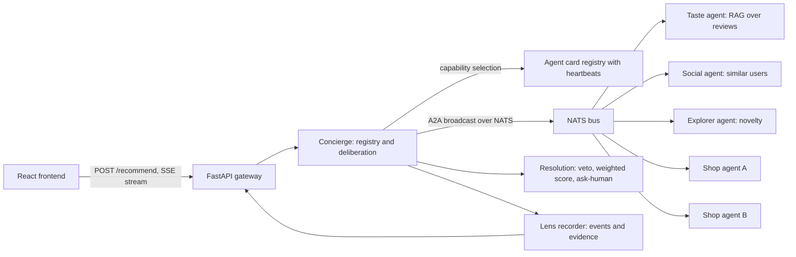

# TeaLink architecture

TeaLink is an explainable multi-agent boba recommender. Match scores, factor contributions, vetoes, and the winning drink are computed in Python. LiteLLM, when a model and provider key are set, only writes wording.

`TRANSPORT=local` (the default) runs the same agent classes in-process. `TRANSPORT=agntcy` serves each agent as its own process speaking A2A through `agntcy-app-sdk` on NATS. The gateway falls back to the in-process agent when the broker is down or that agent is not heartbeating. Heartbeats use `tealink.heartbeat` and demo control (join, offline, reset) uses `tealink.control`. Neither subject is part of the HTTP API.

## Deliberation

Schemas live in `backend/tealink/schemas.py`. A session is at most two rounds:

1. The Concierge picks agents based on what their cards say they can do, and logs why each was picked.
2. Every agent sends a `Proposal` with a drink, a score, evidence and a rationale.
3. Every agent rates the other agents' candidates with an `Objection`, which is one of `veto`, `concern` or `support`.
4. The Resolver applies shop vetoes (sold out, offline), then a weighted sum of scores.
5. If the top two are within 0.05 of each other, it sets `ask_human=true` and asks the user a question.
6. Every step is streamed as a `LensEvent`.

Shop heartbeats older than 30 seconds mark that shop offline, so the next selection drops it. `POST /events/shop-join` registers a shop agent. `POST /events/sold-out` and `POST /events/preference` are applied on the next deliberation. Preference overrides replace attributes in the taste profile before the match score is computed.
